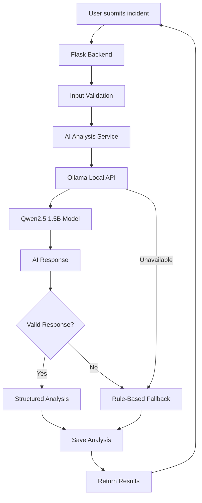
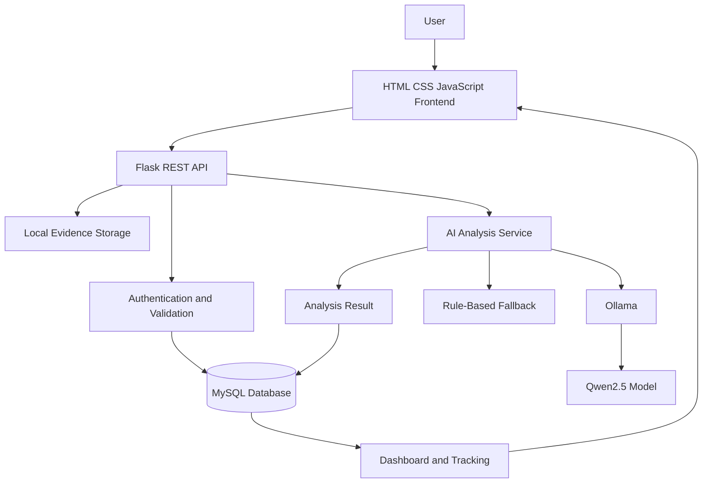

# 🛡️ CYBERSAFE: AI-BASED CYBERCRIME REPORTING WEB APPLICATION

<p align="center">
  
</p>

<p align="center">
  <strong>An AI-assisted cybercrime reporting platform designed to make incident reporting, evidence management and cyber-safety awareness more accessible.</strong>
  <br/>
  Turning cybersecurity concepts into a practical software engineering project.
</p>

<p align="center">
  
  
  
  
</p>

<p align="center">
  
  
  
  
  
</p>

<p align="center">
  <strong>Created by: Kaithepalli Vijay Vardhan</strong>
  <br/>
  B.Tech – Computer Science and Engineering
  <br/>
  Lingayas Institute of Management and Technology
</p>

---

## 🛡️ 01. THE PROJECT

**CyberSafe – AI-Based Cybercrime Reporting Web Application** is a full-stack academic project designed to provide a centralized environment for submitting cybercrime complaints, managing evidence, tracking complaint status and accessing cyber-safety information.

Cybercrime incidents such as phishing, online fraud, identity theft and cyberbullying can leave victims confused about what happened and what steps they should take next.

I wanted to explore how web development, database management and Artificial Intelligence could work together to create a practical platform that helps organize the reporting process.

CyberSafe combines a web-based complaint management system with AI-assisted incident analysis. It uses a locally hosted language model through Ollama to generate preliminary analysis and recommendations, with a rule-based fallback when the local AI service is unavailable or produces an unusable response.

> An effective cybersecurity solution should not only identify problems. It should help people understand them and take informed next steps.

**Project purpose:** Demonstrate how AI and full-stack development can support cybercrime reporting and awareness in an academic prototype.

**Important:** CyberSafe is an academic prototype. It does not replace India's National Cyber Crime Reporting Portal, CERT-In, law enforcement agencies or official cybercrime investigations.

---

## 🚨 02. THE PROBLEM I WANTED TO EXPLORE

Cybercrime affects people through different types of digital attacks and online fraud.

Some common examples include:

- Phishing messages and fraudulent websites.
- Online payment and financial fraud.
- Identity theft and impersonation.
- Cyberbullying and online harassment.
- Ransomware and malicious software.
- Credit card and banking fraud.

I wanted to explore whether a single web application could organize incident information, evidence and complaint progress while also providing preliminary AI-assisted guidance.

CyberSafe was developed around that idea.

---

## ✨ 03. CORE FEATURES

### 📝 Cybercrime Complaint Reporting

Users can submit incident information through a structured reporting interface.

- Incident category selection.
- Detailed incident description.
- Evidence attachment support.
- Complaint submission through the backend.
- Complaint identification and tracking.

### 🧠 AI-Assisted Incident Analysis

CyberSafe integrates a locally hosted AI model through Ollama.

The configured model is **Qwen2.5:1.5b**.

The AI analysis is intended to provide preliminary assistance, including:

- Suggested incident category.
- Preliminary severity assessment.
- Model-generated confidence estimate.
- Illustrative resolution-time estimate.
- Safety recommendations and suggested next steps.

If the local AI service is unavailable or returns an invalid response, the application can use rule-based fallback logic.

**Important:** AI-generated severity, confidence and resolution estimates are preliminary outputs. They are not verified forensic conclusions, official classifications or measured model accuracy.

### 📂 Evidence Management

The application supports attaching evidence to submitted complaints.

Evidence may help organize information related to an incident, such as screenshots and other supporting files.

Evidence handling is part of the academic prototype and should not be treated as a production-grade digital-forensics or chain-of-custody system.

### 🔎 Complaint Tracking

Users can track submitted complaints using their complaint identifiers.

The tracking workflow is designed to make complaint status easier to follow.

### 📊 Dashboard and Data Visualization

The application includes dashboard visualizations using Chart.js.

The dashboards are intended to summarize available application data, such as complaint categories and recorded complaint information.

These charts are descriptive summaries, not validated crime forecasts or predictive intelligence.

### 📚 Cyber-Safety Awareness

The application also provides cyber-safety information and guidance to help users understand common online threats and safer digital practices.

Emergency contact information includes:

- **1930** – India's cyber financial fraud helpline.
- **112** – India's emergency response number.

---

## 🧠 04. AI ARCHITECTURE

One of the most interesting parts of CyberSafe is the integration of a locally hosted language model into a Flask-based web application.

Instead of depending entirely on an external AI API, the project uses Ollama to run the configured Qwen2.5 model locally.

### AI Processing Flow



### AI Technology

| Component | Technology |
|---|---|
| AI Runtime | Ollama |
| Language Model | Qwen2.5:1.5b |
| Integration | OpenAI-compatible local API |
| Backend Integration | Python |
| Fallback | Rule-based analysis |
| Output | Preliminary structured incident analysis |

### Why Local AI?

I wanted to experiment with integrating a language model into a real application without making the entire workflow dependent on a cloud AI service.

This gave me an opportunity to explore:

- Local language model deployment.
- API integration.
- Structured AI responses.
- Input and output validation.
- Fallback handling.
- AI-assisted application workflows.

---

## ⚙️ 05. TECHNOLOGY STACK

| Technology | Purpose |
|---|---|
| HTML5 | Frontend structure |
| CSS3 | User interface and styling |
| JavaScript | Frontend interactions |
| Chart.js | Dashboard visualizations |
| Python | Backend programming |
| Flask | REST API and application backend |
| MySQL | Persistent application data |
| JWT | Authentication |
| Ollama | Local AI model runtime |
| Qwen2.5:1.5b | AI-assisted incident analysis |
| Fernet | Application data encryption support |

### Architecture Overview



The frontend communicates with the Flask backend through API requests. The backend handles application logic, authentication, database operations, evidence handling and AI integration.

---

## 🔐 06. SECURITY AND RESPONSIBLE DEVELOPMENT

CyberSafe is a cybersecurity-focused project, so application security is an important part of its design.

The project includes security-related mechanisms such as:

- JWT-based authentication.
- Backend input validation.
- Protected application routes.
- Configuration through environment variables.
- Fernet-based encryption support.
- Separation of application data and uploaded evidence.
- AI fallback handling when the local model is unavailable.

Security-sensitive operations must be validated on the backend rather than relying only on frontend checks.

### Responsible Use

CyberSafe is an educational prototype and has not been established as a production-ready platform for handling real victims' complaints or sensitive evidence.

Before any real-world deployment, it would require independent security testing, privacy review, access-control verification, secure evidence storage, operational monitoring and appropriate legal and regulatory review.

---

## 📂 07. PROJECT STRUCTURE

```text
cyber-crime-reporting-website/
│
├── backend/
│   ├── app.py
│   ├── config.py
│   ├── services/
│   │   └── ai_service.py
│   ├── uploads/
│   ├── database/
│   ├── requirements.txt
│   └── .env.example
│
├── frontend/
│   ├── index.html
│   ├── css/
│   ├── js/
│   └── ...
│
├── database/
│   └── schema.sql
│
├── tests/
│
├── .gitignore
└── README.md
```

*This is a high-level structure; individual filenames and folders may differ in the current repository.*

---

## 🚀 08. GETTING STARTED

### Requirements

- Windows 10 or Windows 11.
- Python 3.10 or newer.
- MySQL Server 8 or compatible.
- Git.
- Ollama for local AI analysis.
- A modern web browser.

### 1. Clone the Repository

```bash
git clone https://github.com/kaithepallivijayvardhan08-spec/cyber-crime-reporting-website.git
```

### 2. Open the Project

```bash
cd cyber-crime-reporting-website
```

### 3. Create the Python Environment

```powershell
cd backend

py -m venv .venv

.\.venv\Scripts\Activate.ps1
```

### 4. Install Dependencies

```powershell
python -m pip install --upgrade pip

pip install -r requirements.txt
```

### 5. Configure Environment Variables

```powershell
Copy-Item .env.example .env
```

Open `backend/.env` and configure the required database connection and security settings.

Generate strong, unique secret values for the application. Never publish your real `.env` file or credentials.

### 6. Configure the Database

Open MySQL Workbench and execute:

```text
database/schema.sql
```

Configure the corresponding database connection settings in `backend/.env`.

### 7. Configure Local AI

Install Ollama and download the configured model:

```bash
ollama pull qwen2.5:1.5b
```

Make sure the Ollama service is running before testing AI-assisted incident analysis.

### 8. Start the Backend

From the `backend` directory:

```powershell
python app.py
```

### 9. Start the Frontend

Open another terminal:

```powershell
cd frontend

py -m http.server 3000
```

Open the frontend using:

```text
http://localhost:3000
```

The exact startup requirements may depend on the current project configuration and environment variables.

---

## 🧪 09. TESTING AND VALIDATION

Testing is important because an application should not be considered reliable simply because its interface works.

CyberSafe development includes checking backend functionality, Python syntax, application behavior and AI service handling.

### Python Syntax Check

From the project root:

```powershell
py -m py_compile backend/services/ai_service.py
```

### AI Service Test

From the backend directory, use the test command available in the repository:

```powershell
$env:OPENAI_API_KEY = ''
python -m unittest discover -s ..\tests -p 'test_ai_service.py' -v
```

The project also requires database-backed testing with a dedicated test database.

**Testing note:** The commands above are provided as development checks. They do not establish complete application test coverage or production readiness.

---

## 🧠 10. HOW I APPROACH DEVELOPMENT

I enjoy learning through practical implementation rather than limiting myself to theoretical explanations.

While developing CyberSafe, I explored how frontend interfaces, backend APIs, databases and AI services could work together in one application.

My development approach is iterative and AI-assisted.

I use AI tools to explore ideas, understand unfamiliar concepts, investigate errors and accelerate development. However, generated code is not automatically treated as correct. I believe in running the application, checking the implementation, testing the behavior and investigating problems.

My approach:

| Step | Development Approach |
|---|---|
| 01 | Understand the problem |
| 02 | Identify the required features |
| 03 | Break the work into smaller tasks |
| 04 | Explore technologies and implementation approaches |
| 05 | Develop and integrate the features |
| 06 | Test the application |
| 07 | Investigate errors and unexpected behavior |
| 08 | Improve the implementation |

I believe debugging is an important part of learning. When something does not work, understanding the reason is more valuable than applying a random fix.

---

## 👨‍💻 11. ABOUT THE DEVELOPER

**Kaithepalli Vijay Vardhan**

*B.Tech – Computer Science and Engineering*  
*Lingayas Institute of Management and Technology*

I am a Computer Science and Engineering student interested in understanding how technology works and how different areas of computing can be combined to solve practical problems.

My interest in cybersecurity grew through exploring how applications, networks, operating systems and digital systems work behind the scenes.

I became particularly interested in the connection between **Artificial Intelligence and Cybersecurity**.

I enjoy exploring unfamiliar technologies, experimenting with different approaches and turning ideas into working applications.

### Why I Built CyberSafe

I wanted to explore how Artificial Intelligence could be integrated into a cybercrime reporting workflow.

Rather than building only a basic complaint submission form, I wanted to understand how a complete application could connect:

- User authentication.
- Complaint reporting.
- Database management.
- Evidence handling.
- AI-assisted incident analysis.
- Dashboard visualization.
- Complaint tracking.

Building CyberSafe gave me an opportunity to explore these components together and understand the challenges involved in full-stack application development.

### What I Learned Through This Project

**1. Backend Development**

Working with Flask helped me understand how application routes, APIs, request handling and backend logic connect with a frontend application.

**2. Database Integration**

Working with MySQL helped me explore how structured information can be stored and managed across different application components.

**3. AI Integration**

Integrating Ollama and Qwen2.5 helped me explore local language model deployment, API communication, response validation and fallback mechanisms.

**4. Cybersecurity Concepts**

The project gave me practical exposure to authentication, input validation, sensitive data handling and responsible application design.

**5. Debugging and Problem-Solving**

Connecting multiple technologies introduced integration challenges. Investigating those problems helped me understand the importance of testing individual components and the complete workflow.

### My Technical Interests

`Artificial Intelligence` · `Cybersecurity` · `Machine Learning` · `Threat Detection` · `Linux` · `Networking` · `Python` · `Web Development` · `Automation` · `Intelligent Systems`

### What I Value in Development

- **Understanding over memorising:** I want to understand why something works.
- **Experimentation over assumptions:** I enjoy testing different approaches.
- **Problem-solving over shortcuts:** I prefer finding the actual cause of an issue.
- **Continuous improvement:** I believe every project offers opportunities to learn.
- **Responsible engineering:** Security and reliability matter alongside functionality.

### Future Vision

I want to continue exploring the intersection of Artificial Intelligence, Cybersecurity and Software Engineering.

My interests include AI-powered security systems, automated threat detection, intelligent security analysis and practical cybersecurity tools.

My goal is to strengthen my technical knowledge by building useful applications, understanding their architecture and continuously improving the way I develop software.

> I don't want to learn technologies just to say that I know them. I want to understand them well enough to build something meaningful with them.

---

## 🔮 12. LIMITATIONS AND FUTURE IMPROVEMENTS

CyberSafe is an academic prototype. There are important areas that require further development before real-world deployment.

### Current Limitations

- AI analysis is preliminary and is not a verified forensic assessment.
- Model-generated confidence values are not independently calibrated accuracy measurements.
- Resolution-time estimates are illustrative.
- Dashboard visualizations summarize available data and are not validated crime predictions.
- Local evidence storage requires stronger production-grade protection and retention controls.
- The application has not undergone a complete independent security audit.
- Database-backed workflows require dedicated testing and validation.

### Future Development Goals

- Benchmark AI analysis against a properly labelled dataset.
- Improve incident classification and evaluation.
- Strengthen evidence security and access controls.
- Add more comprehensive audit logging.
- Conduct privacy and security assessments.
- Improve automated test coverage.
- Evaluate usability through structured user testing.
- Explore responsible threat-intelligence integration.

I believe being honest about limitations is part of responsible software development.

---

## 📚 13. PROJECT PURPOSE AND ACADEMIC CONTEXT

**Project Title:** CyberSafe – AI-Based Cybercrime Reporting Web Application

**Project Type:** Final-Year B.Tech CSE Academic Prototype

**Institution:** Lingayas Institute of Management and Technology

**Domain:** Artificial Intelligence, Cybersecurity and Full-Stack Web Development

This project demonstrates the practical integration of web application development, database management and local AI-assisted analysis.

It is intended for academic learning, demonstration and further experimentation.

---

## 🌐 14. IMPORTANT CYBERCRIME RESOURCES

For actual cybercrime incidents in India, use official reporting channels.

| Resource | Purpose |
|---|---|
| [National Cyber Crime Reporting Portal](https://cybercrime.gov.in/) | Official cybercrime complaint reporting |
| **1930** | Cyber financial fraud helpline |
| [CERT-In](https://www.cert-in.org.in/) | India's national cyber incident response team |
| **112** | Emergency response number |

CyberSafe is not an official government reporting portal. Users should report real incidents through the appropriate official channels.

---

## ❤️ 15. A PERSONAL NOTE

CyberSafe represents my interest in combining Artificial Intelligence and Cybersecurity through practical software development.

During this project, I explored different technologies, connected multiple application components and worked through problems that required investigation and repeated testing.

I learned that building a full-stack application is not just about writing code. It also involves understanding how different components communicate, how information is managed, how failures are handled and how security should be considered throughout development.

I know there is still a lot for me to learn. I see this project as part of my engineering journey rather than the final destination.

I want to continue exploring new technologies, challenging myself with practical problems and developing applications that combine intelligent systems with responsible engineering.

**Built with curiosity. Developed through experimentation. Improved through continuous learning.**

<p align="center">
  
  <strong>CYBERSAFE — MAKING CYBERSECURITY MORE ACCESSIBLE THROUGH TECHNOLOGY.</strong>
  <br/>
  <sub>Developed by Kaithepalli Vijay Vardhan</sub>
</p>

---

## 📝 License

Add the applicable project license here before publishing. Do not claim a particular license unless the repository contains the corresponding license file.
