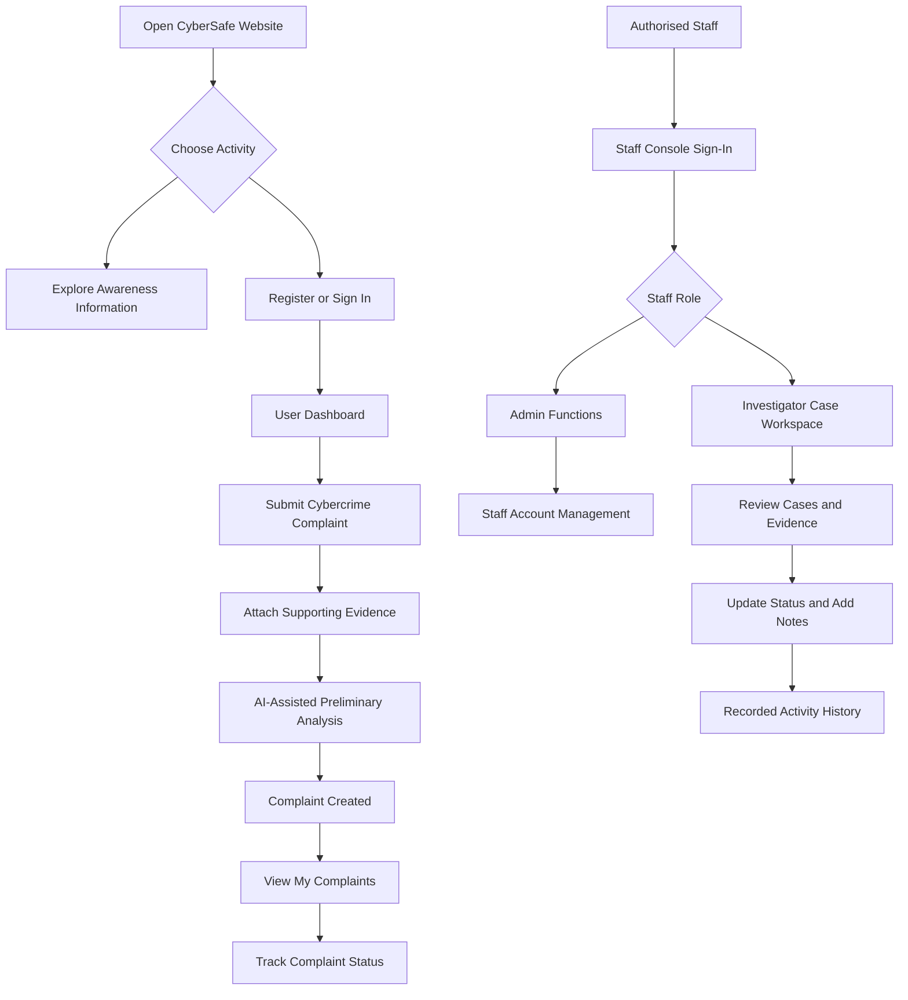
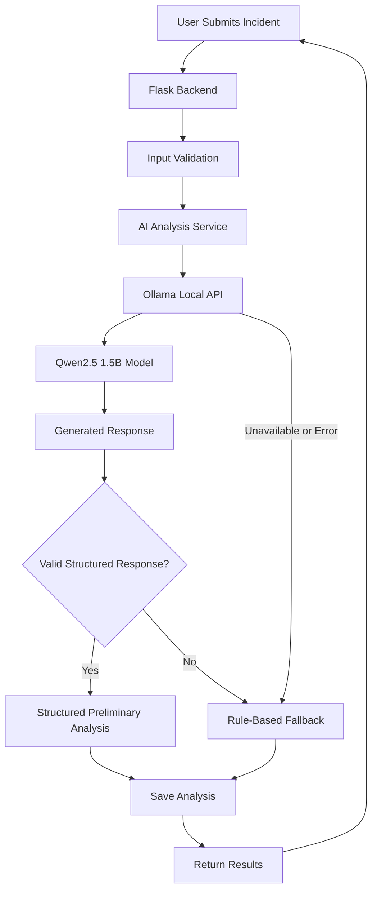
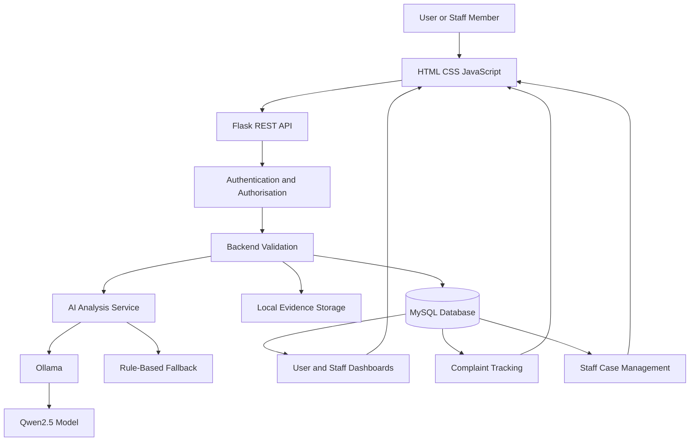

# 🛡️ CYBERSAFE — AI-POWERED CYBERCRIME REPORTING WEB APPLICATION

<p align="center">
  
</p>

<p align="center">
  <strong>A cybercrime reporting and case-management platform with AI-assisted incident analysis.</strong>
  <br/>
  Bringing together digital reporting, evidence handling, complaint tracking and cybersecurity awareness.
</p>

<p align="center">
  
  
  
  
</p>

<p align="center">
  
  
  
  
  
  
</p>

<p align="center">
  <strong>Developed by Kaithepalli Vijay Vardhan</strong>
  <br/>
  B.Tech — Computer Science and Engineering
  <br/>
  Lingayas Institute of Management and Technology
</p>

---

## 📡 TABLE OF CONTENTS

| No. | Section |
|---|---|
| 01 | [Project Overview](#-01-project-overview) |
| 02 | [Application Gallery](#-02-cybersafe-application-gallery) |
| 03 | [Public Website](#-03-public-website) |
| 04 | [Admin Console](#-04-admin-console) |
| 05 | [Investigator Workspace](#-05-investigator-workspace) |
| 06 | [Development Workspace](#-06-development-workspace) |
| 07 | [Problem Statement](#-07-problem-statement) |
| 08 | [Core Features](#-08-core-features) |
| 09 | [User Roles and Application Workflow](#-09-user-roles-and-application-workflow) |
| 10 | [AI Architecture](#-10-ai-architecture) |
| 11 | [Technology Stack](#-11-technology-stack) |
| 12 | [Security and Responsible Development](#-12-security-and-responsible-development) |
| 13 | [Project Structure](#-13-project-structure) |
| 14 | [Complete Installation and Setup](#-14-complete-installation-and-setup) |
| 15 | [Running CyberSafe](#-15-running-cybersafe) |
| 16 | [Testing and Validation](#-16-testing-and-validation) |
| 17 | [Troubleshooting](#-17-troubleshooting) |
| 18 | [My Development Approach](#-18-my-development-approach) |
| 19 | [About the Developer](#-19-about-the-developer) |
| 20 | [Current Limitations](#-20-current-limitations) |
| 21 | [Future Improvements](#-21-future-improvements) |
| 22 | [Academic Project Information](#-22-academic-project-information) |
| 23 | [Research Publication](#-23-research-publication) |
| 24 | [Official Cybercrime Resources](#-24-official-cybercrime-resources) |
| 25 | [A Personal Note](#-25-a-personal-note) |

---

# 🛡️ 01. PROJECT OVERVIEW

**CyberSafe — AI-Based Cybercrime Reporting Web Application** is a full-stack academic project developed to explore how modern web technologies and Artificial Intelligence can support a cybercrime reporting and case-management workflow.

Cybercrime has become a serious concern for people who use the internet for everyday activities. Phishing, online payment fraud, identity theft, fraudulent websites and other digital attacks can cause financial loss, privacy problems and personal stress.

When an incident happens, people may not know how to organise the details, preserve evidence or understand the next steps.

I wanted to explore how a single web application could bring these activities together.

CyberSafe combines a public-facing reporting website with a separate staff console for administrative and investigative work.

The application includes:

- A public website for cyber-safety information and user access.
- User registration and login.
- Cybercrime complaint submission.
- Supporting evidence uploads.
- AI-assisted incident analysis.
- Complaint status and timeline tracking.
- User dashboards and visual reports.
- A separate staff console.
- Admin and investigator account roles.
- Case management and evidence review.
- Staff activity history.

The AI component uses a locally hosted language model through **Ollama**, with **Qwen2.5:1.5b** configured for preliminary incident analysis.

The application also includes rule-based fallback handling when the local AI service is unavailable or returns an unusable response.

### Project Goal

My goal was to understand how different areas of software development can work together to build a practical application.

This project gave me an opportunity to explore:

- Full-stack web development.
- Python and Flask backend development.
- MySQL database integration.
- User authentication and role-based access.
- Local language model integration.
- Evidence upload and management.
- Dashboard development.
- Application testing and debugging.
- Cybersecurity concepts and responsible development.

> Technology becomes more meaningful when we use it to understand real problems and build practical solutions.

**Important:** CyberSafe is an academic prototype. It is not an official government cybercrime reporting system and does not replace India's National Cyber Crime Reporting Portal, CERT-In, law enforcement agencies or official investigations.

---

# 🖥️ 02. CYBERSAFE APPLICATION GALLERY

The following gallery contains screenshots from the actual CyberSafe project.

I have separated the screenshots into different application areas so that visitors can understand how the platform is organised.

### Gallery organisation

| Application Area | What it contains |
|---|---|
| Public Website | Home page, information pages, registration, reporting and user dashboard |
| Admin Console | Staff sign-in and administration dashboard |
| Investigator Workspace | Case management, complaint review, evidence and activity history |
| Development Workspace | A view of the local development environment |

**Image alignment:** The application screenshots use a consistent two-column layout. Each image is placed inside its own table cell, with its title and description directly below it.

---

# 🌐 03. PUBLIC WEBSITE

The Public Website is the user-facing part of CyberSafe.

It is designed for people who want to learn about cyber safety, create an account, submit a cybercrime report and follow their complaint information.

## 3.1 Home Page and Information Pages

<table>
<tr>
<td width="50%" align="center" valign="top">

<p><strong>01. CyberSafe Home Page</strong></p>
<p>Main landing page introducing the CyberSafe reporting platform and its primary actions.</p>
</td>
<td width="50%" align="center" valign="top">

<p><strong>02. About CyberSafe</strong></p>
<p>Introduction to the platform, its mission and its vision.</p>
</td>
</tr>
<tr>
<td width="50%" align="center" valign="top">

<p><strong>03. CyberSafe Services</strong></p>
<p>Overview of reporting, AI-assisted analysis and complaint tracking.</p>
</td>
<td width="50%" align="center" valign="top">

<p><strong>04. Cyber Awareness Library</strong></p>
<p>Cybersecurity awareness content covering common online threats and safer digital practices.</p>
</td>
</tr>
<tr>
<td width="50%" align="center" valign="top">

<p><strong>05. Awareness Videos and Resources</strong></p>
<p>Educational video cards and downloadable cyber-safety resources.</p>
</td>
<td width="50%" align="center" valign="top">

<p><strong>06. Cyber-Safety Handbook</strong></p>
<p>Example of a downloadable safety resource opened from the awareness section.</p>
</td>
</tr>
</table>

## 3.2 User Registration and Authentication

<table>
<tr>
<td width="50%" align="center" valign="top">

<p><strong>07. User Registration</strong></p>
<p>Account creation interface for new CyberSafe users.</p>
</td>
<td width="50%" align="center" valign="top">

<p><strong>08. User Login</strong></p>
<p>Login interface for registered users.</p>
</td>
</tr>
<tr>
<td width="50%" align="center" valign="top">

<p><strong>09. Login Confirmation</strong></p>
<p>Example of the successful login notification shown by the website.</p>
</td>
<td width="50%" align="center" valign="top">

<p><strong>10. User Dashboard</strong></p>
<p>Personal dashboard displaying complaint information and available summaries.</p>
</td>
</tr>
</table>

## 3.3 Complaint Reporting and AI Analysis

<table>
<tr>
<td width="50%" align="center" valign="top">

<p><strong>11. Cybercrime Report Form</strong></p>
<p>Form for entering the incident type, description, date and location.</p>
</td>
<td width="50%" align="center" valign="top">

<p><strong>12. AI Analysis and Evidence Upload</strong></p>
<p>Preliminary analysis results, suggested actions and the supporting evidence upload area.</p>
</td>
</tr>
<tr>
<td width="50%" align="center" valign="top">

<p><strong>13. Complaint Submission Confirmation</strong></p>
<p>Confirmation message displayed after a complaint is successfully submitted.</p>
</td>
<td width="50%" align="center" valign="top">

<p><strong>14. My Complaints</strong></p>
<p>List of complaints associated with the signed-in user.</p>
</td>
</tr>
</table>

## 3.4 Complaint Tracking and AI Insights

<table>
<tr>
<td width="50%" align="center" valign="top">

<p><strong>15. Complaint Tracking</strong></p>
<p>Complaint lookup and status information using the complaint identifier.</p>
</td>
<td width="50%" align="center" valign="top">

<p><strong>16. Tracking Timeline and Analysis</strong></p>
<p>View of preliminary analysis, recommendations and complaint status history.</p>
</td>
</tr>
<tr>
<td width="50%" align="center" valign="top">

<p><strong>17. AI Insights Dashboard</strong></p>
<p>Visual summaries of complaint categories and available historical application data.</p>
</td>
<td width="50%" align="center" valign="top">

<p><strong>18. Complaint Status History</strong></p>
<p>Example of a complaint timeline showing recorded status updates.</p>
</td>
</tr>
<tr>
<td width="50%" align="center" valign="top">

<p><strong>19. User Dashboard Overview</strong></p>
<p>Another view of the user dashboard and its complaint summary cards.</p>
</td>
<td width="50%" align="center" valign="top">
</td>
</tr>
</table>

---

# 🛠️ 04. ADMIN CONSOLE

The Admin Console is the staff-facing administration area.

It is separate from the public website. Staff members use their authorised accounts to access the case-management environment.

The application supports two staff roles:

- **Admin:** Administrative access, including staff account management.
- **Investigator:** Access to the staff case-management workflow according to the assigned role.

## 4.1 Staff Console Access

<table>
<tr>
<td width="50%" align="center" valign="top">

<p><strong>01. Staff Console Sign-In</strong></p>
<p>Separate login screen for authorised administrators and investigators.</p>
</td>
<td width="50%" align="center" valign="top">

<p><strong>02. Admin Account Sign-In Example</strong></p>
<p>Another captured view of the staff console login page.</p>
</td>
</tr>
</table>

## 4.2 Administration Dashboard

<table>
<tr>
<td width="50%" align="center" valign="top">

<p><strong>03. Staff Dashboard</strong></p>
<p>Overview of complaint totals, recorded statuses, recent cases and staff workspace navigation.</p>
</td>
<td width="50%" align="center" valign="top">
</td>
</tr>
</table>

The staff console provides navigation to:

- Dashboard.
- Cases.
- Evidence.
- Activity.
- Staff accounts.

The staff account management option is intended for administrators.

**Role terminology:** The staff console is shared by Admin and Investigator accounts. The dashboard screenshot above shows an Admin account. The case-management screenshots in the next section were also captured during an Admin session; they demonstrate the shared staff workspace rather than a separate investigator-only website.

---

# 🔎 05. INVESTIGATOR WORKSPACE

The Investigator Workspace is the case-management part of the staff console.

Its purpose is to make complaint information easier for authorised staff to review and manage.

The workspace includes case listing, case details, evidence review, status updates and recorded activity.

## 5.1 Case Management

<table>
<tr>
<td width="50%" align="center" valign="top">

<p><strong>01. Case Management List</strong></p>
<p>Search, filter and review submitted complaints from the staff workspace.</p>
</td>
<td width="50%" align="center" valign="top">

<p><strong>02. Case Details and Incident Information</strong></p>
<p>Detailed view of the submitted complaint, reporter information and incident description.</p>
</td>
</tr>
<tr>
<td width="50%" align="center" valign="top">

<p><strong>03. Case Evidence and Preliminary Analysis</strong></p>
<p>View of attached evidence and the AI-generated preliminary assessment associated with a case.</p>
</td>
<td width="50%" align="center" valign="top">

<p><strong>04. Case Status Update</strong></p>
<p>Staff interface for selecting a new complaint status.</p>
</td>
</tr>
<tr>
<td width="50%" align="center" valign="top">

<p><strong>05. Status Update and Case Notes</strong></p>
<p>Example of a staff member entering a note while updating a case status.</p>
</td>
<td width="50%" align="center" valign="top">
</td>
</tr>
</table>

## 5.2 Evidence Review and Activity History

<table>
<tr>
<td width="50%" align="center" valign="top">

<p><strong>06. Evidence Inbox</strong></p>
<p>Staff-facing evidence area for finding and reviewing files attached to complaints.</p>
</td>
<td width="50%" align="center" valign="top">

<p><strong>07. Staff Activity Log</strong></p>
<p>Recorded case status events and activity information from the staff workspace.</p>
</td>
</tr>
</table>

### Investigator Workflow

The staff case-management workflow can be understood in the following order:

1. Sign in using an authorised staff account.
2. Open the case dashboard.
3. View the list of submitted complaints.
4. Search or filter cases.
5. Open a complaint to review its information.
6. Examine the available evidence and preliminary AI analysis.
7. Update the complaint status when appropriate.
8. Add a case note.
9. Review the recorded activity history.

The application supports staff roles, but the displayed AI analysis and complaint information should always be treated as preliminary application data. They are not official investigative findings.

---

# 💻 06. DEVELOPMENT WORKSPACE

This final screenshot is different from the application screenshots. It shows the local development environment used while working on the project.

<table>
<tr>
<td width="50%" align="center" valign="top">

<p><strong>01. Development and Repository Maintenance</strong></p>
<p>Visual Studio Code and PowerShell during project maintenance and development.</p>
</td>
<td width="50%" align="center" valign="top">
</td>
</tr>
</table>

This image is included as a development-workflow reference, not as a feature of the CyberSafe application.

---

# 🚨 07. PROBLEM STATEMENT

Cybercrime affects people through different types of digital attacks and online fraud.

Some common examples include:

- Phishing emails and fraudulent websites.
- Online payment and financial fraud.
- Identity theft and impersonation.
- Cyberbullying and online harassment.
- Ransomware and malicious software.
- Credit card and banking fraud.
- Social media account compromise.
- Unauthorised access to online accounts.

When an incident happens, people may face several problems:

1. They may not know how to describe the incident clearly.
2. They may not know which evidence to preserve.
3. They may find it difficult to follow complaint updates.
4. They may not understand common cyber threats.
5. They may need basic guidance about the next steps.

I wanted to explore whether one application could organise these activities in a structured way.

### The Main Idea

CyberSafe brings together:

1. Incident information collection.
2. Complaint submission.
3. Evidence attachment.
4. Preliminary AI-assisted analysis.
5. Complaint status tracking.
6. Staff case management.
7. Cyber-safety awareness.

The purpose is to demonstrate how these features can work together in one web application.

---

# ✨ 08. CORE FEATURES

## 8.1 Cybercrime Complaint Reporting

Users can submit incident information through a structured reporting interface.

The reporting process includes:

- Incident category selection.
- Detailed incident description.
- Incident date.
- Incident location.
- Additional information.
- Supporting evidence files.
- Complaint submission through the backend.
- Complaint identification.

The application generates a complaint identifier after a successful submission.

## 8.2 AI-Assisted Incident Analysis

CyberSafe integrates a locally hosted language model through Ollama.

The configured model is:

**Qwen2.5:1.5b**

The AI service is intended to provide preliminary information such as:

- Suggested incident category.
- Preliminary severity assessment.
- Model-generated confidence estimate.
- Suggested safety actions.
- Illustrative resolution-time estimate.

If the Ollama service is unavailable or returns an unusable response, rule-based fallback logic can provide an alternative preliminary assessment.

**Important:** The AI output is not a verified forensic conclusion, official crime classification or guaranteed prediction. Confidence values are not independently calibrated measurements of model accuracy.

## 8.3 Evidence Upload and Management

The reporting interface supports attaching files to complaints.

The configured allowed file extensions are:

- PNG.
- JPG.
- JPEG.
- PDF.
- TXT.

The configured maximum request size is 16 MB.

Evidence files are stored locally by the application, with database records used to associate files with complaints.

The staff console includes an evidence inbox for authorised staff to find and review submitted files.

This is an academic evidence-management feature. It is not a complete digital-forensics or chain-of-custody system.

## 8.4 Complaint Tracking

Users can view their complaint information and status history.

The tracking workflow includes:

- Complaint identifier.
- Incident category.
- Current recorded status.
- Incident details.
- Preliminary analysis, when available.
- Recorded status timeline.

The tracking API requires an authenticated account and checks that the complaint belongs to the signed-in user.

## 8.5 User Dashboard

The user dashboard presents available complaint information.

It includes summaries such as:

- Total complaints.
- Active complaints.
- Resolved complaints.
- Response-rate information.
- Recent complaint records.
- Complaint visualisations.

The dashboard is intended to summarise the data available in the application.

## 8.6 Admin Console

The staff console provides a separate environment for authorised staff.

It includes:

- Staff sign-in.
- Dashboard.
- Case navigation.
- Evidence navigation.
- Activity navigation.
- Staff account administration.

Only an authorised Admin account can create additional staff accounts through the administration endpoint.

## 8.7 Investigator Case Management

The case-management workspace provides staff with access to complaint records.

Its available workflow includes:

- Viewing complaint records.
- Searching by case number, incident type or reporter.
- Filtering by status and priority.
- Opening case details.
- Reviewing supporting evidence.
- Viewing preliminary AI analysis.
- Updating case status.
- Adding case notes.

## 8.8 Staff Activity History

The staff console includes an activity log for recorded complaint status events.

It helps organise information about recorded case updates and the staff member associated with an update.

## 8.9 Cyber-Safety Awareness

The public website includes an awareness section with educational content and downloadable resources.

The aim is to help users understand common online threats and safer digital practices.

The application also displays important Indian emergency and cybercrime contact information.

## 8.10 AI Fallback Handling

A local AI service may sometimes be unavailable, slow or return an invalid response.

CyberSafe includes rule-based fallback handling for its AI analysis workflow.

This provides an alternative preliminary result when the local model response cannot be used.

---

# 👥 09. USER ROLES AND APPLICATION WORKFLOW

CyberSafe has a public-facing website and a separate staff console.

The distinction is important because ordinary users and staff members have different responsibilities.

## 9.1 Application Roles

| Role | Main Responsibility |
|---|---|
| Public Visitor | Explore the website and cyber-safety information |
| Registered User | Submit complaints, attach evidence and view personal complaint information |
| Admin | Access staff administration and case-management functions |
| Investigator | Access the authorised staff case-management workflow |

### Registered User

A registered user can:

- Create an account.
- Sign in.
- Submit a cybercrime complaint.
- Attach supporting evidence.
- View their complaints.
- Check complaint status.
- View available AI-assisted analysis.
- Access cyber-safety information.

### Admin

An Admin account is intended for administrative work.

The current staff console provides an Admin-only staff-account creation operation.

An Admin can create staff accounts with either of these roles:

- Admin.
- Investigator.

### Investigator

An Investigator account is intended for authorised case-management work.

The staff console provides access to case-management, evidence and activity pages for authorised staff accounts.

### Important Role Distinction

The Admin Console and Investigator Workspace are not two unrelated applications.

They are parts of the same staff console. The account role determines which staff operations are permitted.

## 9.2 General Application Workflow



---

# 🧠 10. AI ARCHITECTURE

One of the most interesting parts of CyberSafe is the integration of a locally hosted language model into a Flask-based web application.

Instead of depending entirely on a cloud AI service, the report-analysis service uses Ollama and its local OpenAI-compatible API.

The configured model is **Qwen2.5:1.5b**.

## 10.1 AI Processing Flow



## 10.2 AI Technology

| Component | Technology |
|---|---|
| AI Runtime | Ollama |
| Language Model | Qwen2.5:1.5b |
| Local API | OpenAI-compatible Ollama endpoint |
| API Address | `http://localhost:11434/v1` |
| Backend Integration | Python |
| AI Client Library | OpenAI Python client |
| Fallback | Rule-based analysis |
| Output | Preliminary structured incident analysis |

## 10.3 Why Local AI?

I wanted to experiment with integrating a language model into a real application without making the entire workflow dependent on an external AI service.

Using Ollama gave me an opportunity to explore:

- Local language model deployment.
- Model installation and execution.
- API communication.
- Structured AI responses.
- Input and output validation.
- Fallback handling.
- Connecting an AI service with a backend application.

## 10.4 AI Response Validation

An AI model does not always return exactly the information an application expects.

For that reason, the AI service checks whether the response can be parsed and whether required fields are available.

The service also handles cases where the local model cannot be reached or returns an unusable response.

## 10.5 Responsible AI Interpretation

AI-generated information should be treated as assistance, not as an authoritative decision.

The model may misunderstand an incident description, omit important details or generate an incorrect recommendation.

For that reason:

- AI severity is preliminary.
- AI confidence is not verified model accuracy.
- Resolution estimates are illustrative.
- Recommendations should be checked before being acted upon.
- AI results must not replace official investigations.

---

# ⚙️ 11. TECHNOLOGY STACK

CyberSafe combines frontend development, backend programming, database integration, authentication and local AI.

## 11.1 Technologies Used

| Technology | Purpose |
|---|---|
| HTML5 | Frontend structure |
| CSS3 | Interface styling |
| JavaScript | Frontend interactions |
| Chart.js | Dashboard visualisations |
| Python | Backend programming |
| Flask | REST API and application backend |
| MySQL | Relational database |
| PyMySQL | MySQL connectivity |
| Flask-JWT-Extended | JWT authentication |
| Flask-Bcrypt | Password hashing |
| Flask-Limiter | Request rate limiting |
| Ollama | Local AI runtime |
| Qwen2.5:1.5b | AI-assisted incident analysis |
| OpenAI Python client | Communication with Ollama's compatible API |
| Cryptography / Fernet | Encryption utility support |
| Pillow | Image processing support |
| python-dotenv | Environment configuration |
| Redis | Available dependency for rate-limit storage configuration |

## 11.2 Application Architecture



## 11.3 Application Layers

| Layer | Responsibility |
|---|---|
| Frontend | User interface and interaction |
| Backend | Application logic and API handling |
| Authentication | User identity and protected access |
| Database | Persistent application information |
| Evidence Storage | Supporting complaint files |
| AI Service | Preliminary incident analysis |
| Staff Console | Administrative and case-management operations |
| Dashboard | Visual summaries of available application data |

---

# 🔐 12. SECURITY AND RESPONSIBLE DEVELOPMENT

CyberSafe is a cybersecurity-focused project, so security is an important part of its design.

The repository includes several security-related mechanisms.

### 12.1 Authentication

The application uses JSON Web Tokens (JWT) for authenticated API access.

Protected routes require valid authentication.

### 12.2 Password Handling

The backend uses Flask-Bcrypt for password hashing.

Passwords should not be stored as plain text.

### 12.3 Role-Based Access

The backend checks staff roles before allowing protected staff operations.

The staff account creation endpoint is restricted to Admin accounts.

Case-management and evidence endpoints check for authorised Admin or Investigator access.

### 12.4 Backend Input Validation

User-submitted information is checked by the backend.

Frontend validation can improve usability, but it should not be the only security control.

### 12.5 Rate Limiting

Flask-Limiter is used to restrict request rates on selected application endpoints.

The default development configuration uses in-memory rate-limit storage. A production system would need an appropriate shared and persistent storage configuration.

### 12.6 CORS and Security Headers

The Flask application configures allowed frontend origins and applies security-related response headers.

### 12.7 Evidence Handling

Evidence files are validated before they are stored.

The staff evidence endpoint requires authorised staff access.

However, local file storage is not a replacement for production-grade evidence protection.

### 12.8 Environment Configuration

Sensitive configuration values should be maintained outside the public source code.

The project uses environment variables for database settings, application secrets and optional configuration.

### 12.9 Encryption Support

The project includes Fernet-based encryption support.

This should not be interpreted as a guarantee that every database field, uploaded file, log or backup is automatically encrypted.

### 12.10 Responsible Development

CyberSafe is an academic prototype and is not ready to handle real victims' complaints or sensitive evidence in a public production environment.

Before any real-world deployment, it would require:

- Independent security testing.
- Privacy and data-protection review.
- Access-control verification.
- Secure evidence storage.
- Proper data retention and deletion policies.
- HTTPS and secure deployment configuration.
- Database backup and recovery planning.
- Monitoring and incident response procedures.
- Legal and regulatory review.

---

# 📂 13. PROJECT STRUCTURE

The following structure reflects the main directories and files in the repository.

```text
cyber-crime-reporting-website/
│
├── backend/
│   ├── app.py
│   ├── config.py
│   ├── create_staff_account.py
│   ├── run_backend_with_admin.ps1
│   ├── requirements.txt
│   │
│   ├── database/
│   │   ├── __init__.py
│   │   └── db_connection.py
│   │
│   ├── middleware/
│   │   ├── rate_limit.py
│   │   └── security_headers.py
│   │
│   ├── models/
│   │   ├── user.py
│   │   ├── complaint.py
│   │   ├── evidence.py
│   │   └── tracking.py
│   │
│   ├── routes/
│   │   ├── auth_routes.py
│   │   ├── crime_routes.py
│   │   ├── ai_routes.py
│   │   ├── dashboard_routes.py
│   │   ├── tracking_routes.py
│   │   ├── contact_routes.py
│   │   └── awareness_routes.py
│   │
│   ├── services/
│   │   ├── ai_service.py
│   │   ├── email_service.py
│   │   ├── encryption_service.py
│   │   └── file_service.py
│   │
│   ├── utils/
│   │   ├── helpers.py
│   │   ├── logger.py
│   │   └── validators.py
│   │
│   ├── uploads/
│   │   └── evidences/
│   │
│   ├── logs/
│   │
│   └── .env
│
├── frontend/
│   ├── index.html
│   ├── admin-console.html
│   ├── investigator-cases.html
│   ├── investigator-evidence.html
│   ├── investigator-activity.html
│   ├── investigator-staff.html
│   │
│   ├── pages/
│   │   ├── about.html
│   │   ├── services.html
│   │   ├── awareness.html
│   │   ├── contact.html
│   │   ├── login.html
│   │   ├── register.html
│   │   ├── dashboard.html
│   │   ├── report-crime.html
│   │   ├── my-complaints.html
│   │   ├── track-complaint.html
│   │   └── ai-insights.html
│   │
│   ├── css/
│   ├── js/
│   ├── images/
│   └── resources/
│
├── database/
│   ├── init_db.sql
│   └── seed_data.sql
│
├── tests/
│   ├── test_ai_service.py
│   ├── test_auth.py
│   └── test_crime_report.py
│
├── cybersafe images/
│   ├── Screenshot 2026-11-26 210406.png
│   ├── Screenshot 2026-11-26 210531.png
│   ├── Screenshot 2026-11-26 210544.png
│   ├── Screenshot 2026-11-26 210554.png
│   ├── Screenshot 2026-11-26 210621.png
│   ├── Screenshot 2026-11-26 210651.png
│   ├── Screenshot 2026-11-26 210720.png
│   ├── Screenshot 2026-11-26 210740.png
│   ├── Screenshot 2026-11-26 210901.png
│   ├── Screenshot 2026-11-26 210951.png
│   ├── Screenshot 2026-11-26 211053.png
│   ├── Screenshot 2026-11-26 212650.png
│   ├── Screenshot 2026-11-26 212749.png
│   ├── Screenshot 2026-11-26 213321.png
│   ├── Screenshot 2026-11-26 213337.png
│   ├── Screenshot 2026-11-26 213346.png
│   ├── Screenshot 2026-11-26 213451.png
│   ├── Screenshot 2026-11-26 213511.png
│   ├── Screenshot 2026-11-26 213538.png
│   ├── Screenshot 2026-11-26 213600.png
│   ├── Screenshot 2026-11-26 213620.png
│   ├── Screenshot 2026-11-26 213705.png
│   ├── Screenshot 2026-11-26 213720.png
│   ├── Screenshot 2026-11-26 213734.png
│   ├── Screenshot 2026-11-26 213947.png
│   ├── Screenshot 2026-11-26 214010.png
│   ├── Screenshot 2026-11-26 214027.png
│   ├── Screenshot 2026-11-26 214118.png
│   ├── Screenshot 2026-11-26 214157.png
│   └── Screenshot 2026-11-26 215547.png
│
├── deployment.md
├── .gitignore
└── README.md
```

**Note:** Runtime folders such as `.venv`, `uploads` and `logs` may be created locally. The `.env` file is a local configuration file and should not be committed.

---

# 🚀 14. COMPLETE INSTALLATION AND SETUP

This section explains how to set up CyberSafe on a Windows computer using PowerShell.

Follow the steps in order.

## 14.1 System Requirements

Before starting, install the following tools.

| Software | Requirement | Purpose |
|---|---|---|
| Windows | Windows 10 or 11 | Development environment |
| Python | Python 3.10 or newer | Backend application |
| MySQL | MySQL Server 8 or compatible | Database |
| Git | Latest stable version | Repository management |
| Ollama | Current version | Local AI runtime |
| Web Browser | Chrome, Edge or Firefox | Application access |
| MySQL Workbench | Recommended | Database management |
| Visual Studio Code | Recommended | Code editing |

You should also have enough free disk space for Python packages and the local AI model.

## 14.2 Step 1 — Install Python

1. Open the official Python website:

   https://www.python.org/downloads/

2. Download a supported Python 3 version.

3. Run the installer.

4. On the installer screen, enable:

   `Add Python to PATH`

5. Complete the installation.

6. Open a new PowerShell window.

7. Check the installation:

```powershell
py --version
```

Also check:

```powershell
python --version
```

You should see your installed Python version.

If Windows says Python was not found, install Python properly and check the Windows App Execution Aliases and PATH settings.

## 14.3 Step 2 — Install Git

1. Open:

   https://git-scm.com/downloads

2. Download Git for Windows.

3. Run the installer using the recommended options.

4. Open PowerShell.

5. Check Git:

```powershell
git --version
```

## 14.4 Step 3 — Install MySQL

1. Open:

   https://dev.mysql.com/downloads/installer/

2. Download MySQL Installer for Windows.

3. Install MySQL Server.

4. During configuration, choose a suitable root password.

5. Remember the password because it will be needed in the CyberSafe configuration.

6. Install MySQL Workbench if it is not already installed.

7. Start the MySQL service.

8. Open MySQL Workbench.

9. Connect to your local MySQL Server.

Make sure the connection works before continuing.

## 14.5 Step 4 — Install Ollama

Ollama is used to run the configured AI model locally.

1. Open:

   https://ollama.com/download

2. Download the Windows installer.

3. Install Ollama.

4. Open PowerShell.

5. Check the installation:

```powershell
ollama --version
```

6. Download the configured model:

```powershell
ollama pull qwen2.5:1.5b
```

7. Check the installed models:

```powershell
ollama list
```

You should see:

```text
qwen2.5:1.5b
```

The AI service uses Ollama's local OpenAI-compatible endpoint:

```text
http://localhost:11434/v1
```

Make sure Ollama is running when you want to test AI-assisted analysis.

## 14.6 Step 5 — Clone the CyberSafe Repository

Open PowerShell.

Choose the folder where you want to store the project.

For example:

```powershell
cd C:\Users\DELL\OneDrive\Desktop
```

Clone the repository:

```powershell
git clone https://github.com/kaithepallivijayvardhan08-spec/cyber-crime-reporting-website.git
```

Wait for Git to finish downloading the files.

## 14.7 Step 6 — Open the Project Folder

Move into the project directory:

```powershell
cd cyber-crime-reporting-website
```

Check the files:

```powershell
Get-ChildItem
```

You should see folders such as:

```text
backend
frontend
database
tests
cybersafe images
```

## 14.8 Step 7 — Open the Backend Folder

Move into the backend directory:

```powershell
cd backend
```

The backend contains the Flask application, database connection, models, routes, services and requirements.

## 14.9 Step 8 — Create a Python Virtual Environment

Create the virtual environment:

```powershell
py -m venv .venv
```

This creates a local Python environment inside the backend folder.

Activate it:

```powershell
.\.venv\Scripts\Activate.ps1
```

After activation, PowerShell should show a virtual environment indicator similar to:

```text
(.venv)
```

### If PowerShell blocks activation

Run this command in the current PowerShell session:

```powershell
Set-ExecutionPolicy -Scope Process -ExecutionPolicy Bypass
```

Then activate again:

```powershell
.\.venv\Scripts\Activate.ps1
```

This changes the execution policy only for the current PowerShell process.

## 14.10 Step 9 — Upgrade pip

Run:

```powershell
python -m pip install --upgrade pip
```

Wait until pip has finished upgrading.

## 14.11 Step 10 — Install Backend Dependencies

Install the packages listed in the project's requirements file:

```powershell
python -m pip install -r requirements.txt
```

The backend requirements include packages such as:

- Flask.
- Flask-JWT-Extended.
- Flask-Bcrypt.
- Flask-Limiter.
- PyMySQL.
- python-dotenv.
- cryptography.
- Redis.
- OpenAI Python client.
- Pillow.

Wait until the installation finishes.

Check that Python can import Flask:

```powershell
python -c "import flask; print('Flask installed successfully')"
```

## 14.12 Step 11 — Create the Backend Environment File

The backend reads configuration from a local `.env` file.

**Important:** The current tracked GitHub repository does not include a working `backend/.env.example`. Therefore, do not depend on a `Copy-Item .env.example .env` command.

Create the file manually.

From the `backend` directory, run:

```powershell
New-Item -ItemType File -Path .env -Force
```

Open it:

```powershell
notepad .env
```

Add the following configuration, replacing the example values with your own:

```env
# Flask application
FLASK_ENV=development

# Application secrets
SECRET_KEY=REPLACE_WITH_A_UNIQUE_SECRET
JWT_SECRET_KEY=REPLACE_WITH_ANOTHER_UNIQUE_SECRET

# MySQL database
DB_HOST=127.0.0.1
DB_PORT=3306
DB_NAME=cybersafe_db
DB_USER=root
DB_PASSWORD=YOUR_MYSQL_PASSWORD

# Optional encryption key
DATA_ENCRYPTION_KEY=

# File upload configuration
MAX_CONTENT_LENGTH=16777216
UPLOAD_FOLDER=uploads/evidences

# Rate limiting
RATELIMIT_DEFAULT=100/hour
RATELIMIT_STORAGE_URL=memory://

# Frontend origins
CORS_ORIGINS=http://127.0.0.1:3000,http://127.0.0.1:5500

# Optional email configuration
SMTP_HOST=smtp.gmail.com
SMTP_PORT=587
SMTP_USER=
SMTP_PASSWORD=
```

### Generate unique application secrets

Open another PowerShell terminal and run:

```powershell
python -c "import secrets; print(secrets.token_urlsafe(48))"
```

Copy the generated value into `SECRET_KEY`.

Run the command again to generate a different value for `JWT_SECRET_KEY`.

Do not use the same value for both keys.

### Optional encryption key

If you are configuring the project's Fernet encryption support, generate a key using:

```powershell
python -c "from cryptography.fernet import Fernet; print(Fernet.generate_key().decode())"
```

Copy the generated value into `DATA_ENCRYPTION_KEY`.

Keep this key private and safe. Losing an encryption key can make data encrypted with that key unreadable.

Save the `.env` file.

**Never upload your real `.env` file, database password, secret keys or private credentials to GitHub.**

## 14.13 Step 12 — Configure the MySQL Database

This step is important.

The backend expects a MySQL database named:

```text
cybersafe_db
```

The current public repository contains `database/init_db.sql` and `database/seed_data.sql`, but these files are empty. It does not currently provide a populated `schema.sql`.

Therefore, a new installation needs a valid database schema before the application can work correctly.

### Create the database

1. Open MySQL Workbench.
2. Connect to your local MySQL Server.
3. Open a new SQL query tab.
4. Execute:

```sql
CREATE DATABASE IF NOT EXISTS cybersafe_db
CHARACTER SET utf8mb4
COLLATE utf8mb4_unicode_ci;
```

5. Refresh the Schemas panel.
6. Confirm that `cybersafe_db` exists.

### Important database schema requirement

Creating the database alone does not create the tables required by CyberSafe.

The backend expects tables for application information such as:

- `users`
- `complaints`
- `complaint_tracking`
- `evidence_files`
- `ai_analysis`
- `user_activity`
- `awareness_articles`

The table columns must match the SQL queries used by the backend models and routes.

Before starting the application on a fresh database, restore or prepare the complete SQL schema that matches the current project code.

Do not import an empty SQL file and assume that the database is ready.

After the correct tables are available, verify the database settings in `backend/.env`.

For example:

```env
DB_HOST=127.0.0.1
DB_PORT=3306
DB_NAME=cybersafe_db
DB_USER=root
DB_PASSWORD=YOUR_MYSQL_PASSWORD
```

Make sure the MySQL service is running.

## 14.14 Step 13 — Create the First Admin Account

CyberSafe includes a staff-account creation script:

```text
backend/create_staff_account.py
```

Use this script to create the first Admin account in your configured database.

Make sure:

- MySQL is running.
- The database exists.
- The required database tables are available.
- The backend `.env` file is correctly configured.
- The Python virtual environment is active.

From the `backend` directory, run:

```powershell
python create_staff_account.py
```

The script asks for:

1. Full name.
2. Email address.
3. Indian mobile number.
4. Staff role.
5. Password.
6. Password confirmation.

For the first account, select:

```text
admin
```

Review the information and type:

```text
YES
```

when the script asks for confirmation.

The script should create the staff account if the database operation succeeds.

**Important:** Create your own secure staff credentials. Do not depend on example emails or passwords shown in screenshots.

### Create additional staff accounts

After signing in as an Admin, the staff account management functionality can be used to create additional staff accounts.

The supported roles are:

- `admin`
- `investigator`

---

# ▶️ 15. RUNNING CYBERSAFE

The repository includes a PowerShell launcher:

```text
backend/run_backend_with_admin.ps1
```

This launcher is the recommended way to start the local development environment.

It starts:

| Service | Local Address | Purpose |
|---|---|---|
| Public Website | `http://127.0.0.1:3000` | User-facing website |
| Staff Console | `http://127.0.0.1:5500/admin-console.html` | Admin and Investigator access |
| Flask Backend | `http://127.0.0.1:5000` | Backend API |

## 15.1 Step 1 — Check the Required Services

Before starting CyberSafe:

- MySQL Server should be running.
- Ollama should be running if you want local AI analysis.
- Your Python virtual environment should be installed.
- Backend dependencies should be installed.
- The `.env` file should be configured.
- The database tables should be available.

## 15.2 Step 2 — Open the Backend Directory

If you are currently in the project root, run:

```powershell
cd backend
```

Activate the virtual environment if it is not already active:

```powershell
.\.venv\Scripts\Activate.ps1
```

## 15.3 Step 3 — Start the Complete Application

Run:

```powershell
.\run_backend_with_admin.ps1
```

The script starts two local frontend servers and then starts the Flask backend.

It checks whether ports `3000`, `5000` and `5500` are already in use.

If everything starts correctly, the terminal displays the application addresses.

## 15.4 Step 4 — Open the Public Website

Open your browser:

```text
http://127.0.0.1:3000
```

You should see the CyberSafe public home page.

## 15.5 Step 5 — Open the Staff Console

Open another browser tab:

```text
http://127.0.0.1:5500/admin-console.html
```

You should see the separate CyberSafe Staff Console sign-in page.

Sign in using the Admin or Investigator account that you created.

## 15.6 Step 6 — Check the Backend API

Open:

```text
http://127.0.0.1:5000/health
```

The backend health endpoint should return a healthy status response when Flask is running.

## 15.7 Step 7 — Stop the Application

Return to the PowerShell terminal running the launcher.

Press:

```text
Ctrl + C
```

The launcher is designed to stop the frontend servers when the backend process exits.

## 15.8 Alternative — Start Each Service Manually

If you do not want to use the PowerShell launcher, you can start the services separately.

### Terminal 1 — Backend API

```powershell
cd cyber-crime-reporting-website\backend
.\.venv\Scripts\Activate.ps1
python app.py
```

### Terminal 2 — Public Website

```powershell
cd cyber-crime-reporting-website\frontend
py -m http.server 3000 --bind 127.0.0.1
```

### Terminal 3 — Staff Console

```powershell
cd cyber-crime-reporting-website\frontend
py -m http.server 5500 --bind 127.0.0.1
```

Then open:

**Public Website**

```text
http://127.0.0.1:3000
```

**Staff Console**

```text
http://127.0.0.1:5500/admin-console.html
```

**Backend Health Check**

```text
http://127.0.0.1:5000/health
```

---

# 🧪 16. TESTING AND VALIDATION

Testing is important because an application should not be considered reliable simply because its interface opens successfully.

During CyberSafe development, I focused on checking Python syntax, backend behaviour, AI service handling and application workflows.

## 16.1 Python Syntax Check

From the project root:

```powershell
py -m py_compile backend/services/ai_service.py
```

This checks the syntax of the AI service module.

## 16.2 AI Service Test

From the backend directory:

```powershell
python -m unittest discover -s ..\tests -p "test_ai_service.py" -v
```

This runs the AI service test file.

## 16.3 Run the Available Test Suite

From the backend directory:

```powershell
python -m unittest discover -s ..\tests -v
```

Use a dedicated test database for database-backed tests. Do not use a database containing real personal information.

## 16.4 Manual Application Testing

The following areas should be checked when testing the application:

| Testing Area | What to Check |
|---|---|
| Website | Pages open and navigation works |
| Registration | New user registration |
| Login | Authentication behaviour |
| Backend | API requests and responses |
| Database | Database connection and operations |
| Complaint Reporting | Form validation and submission |
| Evidence | File upload and validation |
| AI Service | Ollama communication |
| AI Fallback | Behaviour when Ollama is unavailable |
| User Dashboard | Complaint summaries |
| Complaint Tracking | Complaint information and timeline |
| Staff Login | Admin and Investigator authentication |
| Case Management | Search, filtering and case details |
| Evidence Review | Staff access to uploaded evidence |
| Status Updates | Updating complaint status and adding notes |
| Activity Log | Viewing recorded status events |

**Testing note:** These commands and checks are development tests. They do not prove complete test coverage or production readiness.

---

# 🧰 17. TROUBLESHOOTING

Here are some common problems that may occur during installation and development.

## Problem 1 — Python Was Not Found

Example message:

```text
Python was not found; run without arguments to install from the Microsoft Store.
```

**Solution:**

1. Install Python from the official Python website.
2. Enable `Add Python to PATH` during installation.
3. Close PowerShell.
4. Open a new PowerShell window.
5. Run:

```powershell
py --version
```

If necessary, check the Windows App Execution Aliases settings.

## Problem 2 — Virtual Environment Activation Is Blocked

If PowerShell blocks the activation script, run:

```powershell
Set-ExecutionPolicy -Scope Process -ExecutionPolicy Bypass
```

Then:

```powershell
.\.venv\Scripts\Activate.ps1
```

## Problem 3 — Python Packages Are Missing

Activate the virtual environment and run:

```powershell
python -m pip install -r requirements.txt
```

If pip is outdated:

```powershell
python -m pip install --upgrade pip
```

## Problem 4 — MySQL Connection Failed

Check:

- MySQL Server is running.
- The database exists.
- The database name is correct.
- The username is correct.
- The password is correct.
- The database port is correct.
- The required database tables exist.

Check the values in:

```text
backend/.env
```

## Problem 5 — Database Table Does Not Exist

This can happen when the database has been created but the required tables have not been created.

Check that the complete SQL schema matching the application code has been restored and executed.

The current public repository does not provide a populated schema file.

## Problem 6 — Ollama Is Not Responding

Check the Ollama installation:

```powershell
ollama --version
```

Check the installed models:

```powershell
ollama list
```

Download the configured model if required:

```powershell
ollama pull qwen2.5:1.5b
```

Make sure the Ollama service is running.

The application may use rule-based fallback handling when Ollama cannot be reached.

## Problem 7 — Port Already in Use

The launcher uses:

- Port `3000`.
- Port `5000`.
- Port `5500`.

If a port is already being used by another process, stop the previous server or choose a different port and update the application configuration consistently.

Do not start multiple copies of the launcher at the same time.

## Problem 8 — Staff Login Does Not Work

Check:

1. The staff account exists in the `users` table.
2. The selected account role is `admin` or `investigator`.
3. The email address is correct.
4. The password is correct.
5. The backend is running.
6. The database connection is working.

If this is the first setup, create an Admin account using:

```powershell
python create_staff_account.py
```

## Problem 9 — Evidence Upload Fails

Check:

- The file extension is allowed.
- The file is within the configured upload size limit.
- The backend upload directory can be created.
- The backend process has permission to write files.
- The database is available.

---

# 🧠 18. MY DEVELOPMENT APPROACH

I enjoy learning through practical implementation rather than limiting myself to theoretical explanations.

While developing CyberSafe, I explored how frontend interfaces, backend APIs, databases and AI services could work together in one application.

My development approach is iterative and AI-assisted.

I use AI tools to explore ideas, understand unfamiliar concepts, investigate errors and speed up development. However, generated code is not automatically treated as correct.

I believe in running the application, checking the implementation, testing the behaviour and investigating problems.

## 18.1 My Development Workflow

| Step | Development Approach |
|---|---|
| 01 | Understand the problem |
| 02 | Identify the required features |
| 03 | Break the work into smaller tasks |
| 04 | Explore technologies and implementation approaches |
| 05 | Develop and integrate features |
| 06 | Test the application |
| 07 | Investigate errors and unexpected behaviour |
| 08 | Improve the implementation |

## 18.2 Learning Through Debugging

I believe debugging is an important part of learning.

When something does not work, understanding the reason is more valuable than applying a random fix.

Working with multiple technologies also means that a problem in one component can affect another component.

For example, a frontend issue may be connected to an API response, a backend validation problem or a database operation.

Learning to investigate these connections is an important part of my development journey.

## 18.3 My Development Principles

- **Understanding over memorising:** I want to understand why something works.
- **Experimentation over assumptions:** I enjoy testing different approaches.
- **Problem-solving over shortcuts:** I prefer finding the actual cause of an issue.
- **Testing over guessing:** I believe in checking whether an implementation behaves as expected.
- **Continuous improvement:** I believe every project offers opportunities to learn.
- **Responsible engineering:** Security and reliability matter alongside functionality.

---

# 👨‍💻 19. ABOUT THE DEVELOPER

<p align="center">
  <strong>Kaithepalli Vijay Vardhan</strong>
  <br/>
  B.Tech — Computer Science and Engineering
  <br/>
  Lingayas Institute of Management and Technology
</p>

I am a Computer Science and Engineering student interested in understanding how technology works and how different areas of computing can be combined to solve practical problems.

My interest in cybersecurity grew through exploring how applications, networks, operating systems and digital systems work behind the scenes.

I became particularly interested in the connection between **Artificial Intelligence and Cybersecurity**.

I enjoy exploring unfamiliar technologies, experimenting with different approaches and turning ideas into working applications.

## 19.1 Why I Built CyberSafe

I wanted to explore how Artificial Intelligence could be integrated into a cybercrime reporting workflow.

Rather than building only a basic complaint submission form, I wanted to understand how a complete application could connect:

- User authentication.
- Complaint reporting.
- Database management.
- Evidence handling.
- AI-assisted incident analysis.
- Dashboard visualisation.
- Complaint tracking.
- Staff case management.

Building CyberSafe gave me an opportunity to explore these components together and understand the challenges involved in full-stack application development.

## 19.2 What I Learned Through This Project

### 1. Backend Development

Working with Flask helped me understand how application routes, APIs, request handling and backend logic connect with a frontend application.

### 2. Database Integration

Working with MySQL helped me explore how structured information can be stored and managed across different application components.

### 3. AI Integration

Integrating Ollama and Qwen2.5 helped me explore local language model deployment, API communication, response validation and fallback mechanisms.

### 4. Cybersecurity Concepts

The project gave me practical exposure to authentication, input validation, sensitive data handling and responsible application design.

### 5. Debugging and Problem-Solving

Connecting multiple technologies introduced integration challenges.

Investigating those problems helped me understand the importance of testing individual components and the complete workflow.

## 19.3 My Technical Interests

`Artificial Intelligence` · `Cybersecurity` · `Machine Learning` · `Threat Detection` · `Linux` · `Networking` · `Python` · `Web Development` · `Automation` · `Intelligent Systems`

## 19.4 What I Value in Development

- Understanding over memorising.
- Experimentation over assumptions.
- Problem-solving over shortcuts.
- Testing over guessing.
- Continuous improvement.
- Responsible engineering.

## 19.5 Future Vision

I want to continue exploring the intersection of Artificial Intelligence, Cybersecurity and Software Engineering.

My interests include:

- AI-powered security systems.
- Automated threat detection.
- Intelligent security analysis.
- Cybersecurity automation.
- Practical security tools.
- AI-assisted software development.

My goal is to strengthen my technical knowledge by building useful applications, understanding their architecture and continuously improving the way I develop software.

> I don't want to learn technologies just to say that I know them. I want to understand them well enough to build something meaningful with them.

---

# 🔮 20. CURRENT LIMITATIONS

CyberSafe is an academic prototype. There are important areas that require further development before real-world deployment.

### AI Limitations

- AI analysis is preliminary and is not a verified forensic assessment.
- Model-generated confidence values are not independently calibrated accuracy measurements.
- Resolution-time estimates are illustrative.
- AI-generated recommendations may be incomplete or incorrect.
- Historical dashboard summaries are not validated crime forecasts.
- The application should not make official decisions based on AI output.

### Application Limitations

- Local evidence storage requires stronger production-grade protection.
- The application has not undergone a complete independent security audit.
- Database-backed workflows require further testing.
- Production monitoring and operational procedures need additional work.
- The current repository does not include a complete database schema for a fresh installation.
- The application is not an official government cybercrime reporting system.

### Deployment Limitations

The current project is intended for local development and academic demonstration.

It should not be deployed publicly to receive real cybercrime reports, personal information or sensitive evidence without completing the required security, privacy, database and operational work.

---

# 🚀 21. FUTURE IMPROVEMENTS

There are several areas where CyberSafe could be improved further.

## 21.1 AI and Analysis

- Benchmark AI analysis against a properly labelled dataset.
- Improve incident classification and evaluation.
- Evaluate the consistency of model-generated responses.
- Improve structured output validation.
- Explore responsible AI-assisted threat analysis.

## 21.2 Security and Privacy

- Strengthen evidence security and access controls.
- Add more comprehensive audit logging.
- Conduct privacy and security assessments.
- Improve secure file handling.
- Review data retention and deletion procedures.
- Improve production secret management.

## 21.3 Testing and Reliability

- Improve automated test coverage.
- Expand database-backed tests.
- Test failure scenarios and service availability.
- Evaluate usability through structured user testing.
- Improve error handling and monitoring.
- Add repeatable database setup and migration scripts.

## 21.4 Future Integrations

- Explore responsible threat-intelligence integration.
- Investigate additional incident analysis capabilities.
- Improve dashboard reporting.
- Explore more advanced cybersecurity automation.
- Improve the staff case-management workflow.

I believe being honest about limitations is part of responsible software development.

---

# 🎓 22. ACADEMIC PROJECT INFORMATION

| Detail | Information |
|---|---|
| Project Title | CyberSafe — AI-Based Cybercrime Reporting Web Application |
| Project Type | Final-Year B.Tech CSE Academic Prototype |
| Institution | Lingayas Institute of Management and Technology |
| Domain | Artificial Intelligence, Cybersecurity and Full-Stack Web Development |
| Frontend | HTML, CSS and JavaScript |
| Backend | Python and Flask |
| Database | MySQL |
| AI Runtime | Ollama |
| AI Model | Qwen2.5:1.5b |

### Academic Objective

This project demonstrates the practical integration of web application development, database management and local AI-assisted analysis.

It provides an opportunity to explore how different software engineering components can work together to address a real-world problem.

### Learning Objectives

- Understand full-stack web application architecture.
- Develop backend functionality using Python and Flask.
- Work with relational databases using MySQL.
- Explore authentication and application security.
- Integrate a locally hosted language model.
- Understand AI response validation and fallback handling.
- Practise debugging, testing and incremental development.

The project is intended for academic learning, demonstration and further experimentation.

---

# 📄 23. RESEARCH PUBLICATION

The project author has reported a research publication with the **International Research Journal of Modernization in Engineering Technology and Science (IRJMETS)**.

| Detail | Information |
|---|---|
| Journal Name | International Research Journal of Modernization in Engineering Technology and Science |
| Abbreviation | IRJMETS |
| e-ISSN | 2582-5208 |
| Journal Website | [https://www.irjmets.com/](https://www.irjmets.com/) |
| Paper Title | AI-Based Cybercrime Reporting Web Application |
| Authors | Kaithepalli Vijay Vardhan, Maddali Tarun Kumar, Nuka Praneeth and Dr. Salla Prabhakar |
| Author Affiliations | Undergraduate students and Professor, Department of Computer Science and Engineering, Lingayas Institute of Management & Technology, Vijayawada, Andhra Pradesh, India |
| Journal | International Research Journal of Modernization in Engineering Technology and Science (IRJMETS) |
| e-ISSN | 2582-5208 |
| Volume / Issue | Volume 08, Issue 06 |
| Publication Date | June 2026 |
| DOI | [10.56726/IRJMETS101086](https://doi.org/10.56726/IRJMETS101086) |
| Published Article | [View the published paper (PDF)](https://www.irjmets.com/upload_newfiles/irjmets80600138377/paper_file/irjmets80600138377.pdf) |
| Journal Website | [irjmets.com](https://www.irjmets.com/) |

**Publication note:** The journal's article PDF contains the title, author list, issue information and DOI shown above. The journal's stated peer-review and impact-factor labels are reproduced here as publisher-provided information; they should not be treated as independent confirmation of indexing, accreditation or research quality.

**Publication rights:** This research paper is a separate scholarly publication, not part of the software licence for this repository. Its copyright and reuse permissions are governed by the terms stated by the journal or publisher for the article.

---

# 🌍 24. OFFICIAL CYBERCRIME RESOURCES

For actual cybercrime incidents in India, use official reporting channels.

| Resource | Purpose |
|---|---|
| [National Cyber Crime Reporting Portal](https://cybercrime.gov.in/) | Official cybercrime complaint reporting |
| **1930** | Cyber financial fraud helpline |
| [CERT-In](https://www.cert-in.org.in/) | India's national cyber incident response team |
| **112** | Emergency response number |

**Important:** CyberSafe is not an official government reporting portal. Users should report real incidents through the appropriate official channels.

---

# ❤️ 25. A PERSONAL NOTE

CyberSafe represents my interest in combining Artificial Intelligence and Cybersecurity through practical software development.

During this project, I explored different technologies, connected multiple application components and worked through problems that required investigation and repeated testing.

One of the biggest lessons for me was understanding that building a full-stack application is not just about writing code.

It also involves understanding how different components communicate, how information is stored, how users interact with the application and how errors are handled.

Working on CyberSafe helped me explore these areas in a practical way.

I believe every project should teach something new. Even when something does not work as expected, investigating the reason can be an important part of learning.

My aim is to keep improving my technical knowledge, build more meaningful applications and explore the possibilities of Artificial Intelligence and Cybersecurity.

> **Built with curiosity. Developed through experimentation. Improved through continuous learning.**

---

## 📜 LICENCE

This project is licensed under the **MIT Licence**.

You are free to use, copy, modify, merge, publish, distribute, sublicense and/or sell copies of the software, subject to the conditions in the [LICENSE](LICENSE) file.

The MIT Licence requires the copyright notice and permission notice to be included in copies or substantial portions of the software.

**Copyright © 2026 Kaithepalli Vijay Vardhan.**

> **Scope of this licence:** The MIT Licence applies only to the software and other materials in this repository that the copyright holder is entitled to license under MIT. It does not automatically apply to the separately published research paper, journal content, or third-party images, fonts, libraries, models and other assets. Check their respective licence and copyright terms before reusing them.

---

<p align="center">
  
</p>

<p align="center">
  <strong>CYBERSAFE</strong>
  <br/>
  <em>MAKING CYBERSECURITY MORE ACCESSIBLE THROUGH TECHNOLOGY.</em>
  <br/><br/>
  Developed by <strong>Kaithepalli Vijay Vardhan</strong>
  <br/>
  B.Tech — Computer Science and Engineering
  <br/>
  Lingayas Institute of Management and Technology
</p>
