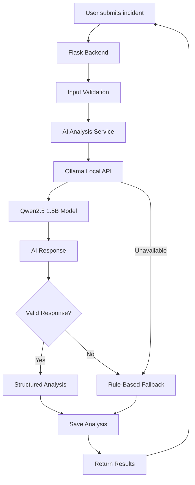
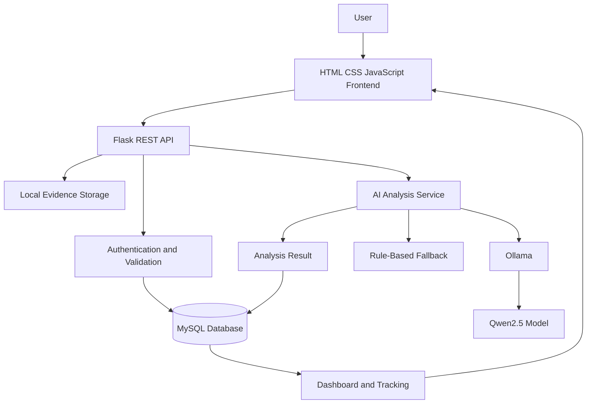

# 🛡️ CYBERSAFE: AI-BASED CYBERCRIME REPORTING WEB APPLICATION

<p align="center">
  
</p>

<p align="center">
  <strong>An AI-assisted cybercrime reporting platform designed to make incident reporting, evidence management and cyber-safety awareness more accessible.</strong>
  <br/>
  Turning cybersecurity concepts into a practical software engineering project.
</p>

<p align="center">
  
  
  
  
</p>

<p align="center">
  
  
  
  
  
</p>

<p align="center">
  <strong>Created by: Kaithepalli Vijay Vardhan</strong>
  <br/>
  B.Tech – Computer Science and Engineering
  <br/>
  Lingayas Institute of Management and Technology
</p>

---

## 📑 TABLE OF CONTENTS

| No. | Section |
|---|---|
| 01 | [The Project](#-01-the-project) |
| 02 | [CyberSafe Application Gallery](#-02-cybersafe-application-gallery) |
| 03 | [The Problem I Wanted to Explore](#-03-the-problem-i-wanted-to-explore) |
| 04 | [Core Features](#-04-core-features) |
| 05 | [AI Architecture](#-05-ai-architecture) |
| 06 | [Technology Stack](#-06-technology-stack) |
| 07 | [Security and Responsible Development](#-07-security-and-responsible-development) |
| 08 | [Project Structure](#-08-project-structure) |
| 09 | [Getting Started](#-09-getting-started) |
| 10 | [Testing and Validation](#-10-testing-and-validation) |
| 11 | [How I Approach Development](#-11-how-i-approach-development) |
| 12 | [About the Developer](#-12-about-the-developer) |
| 13 | [Limitations and Future Improvements](#-13-limitations-and-future-improvements) |
| 14 | [Project Purpose and Academic Context](#-14-project-purpose-and-academic-context) |
| 15 | [Important Cybercrime Resources](#-15-important-cybercrime-resources) |
| 16 | [A Personal Note](#-16-a-personal-note) |

---

## 🛡️ 01. THE PROJECT

**CyberSafe – AI-Based Cybercrime Reporting Web Application** is a full-stack academic project designed to provide a centralised environment for submitting cybercrime complaints, managing evidence, tracking complaint status and accessing cyber-safety information.

Cybercrime is becoming a serious problem for people who use the internet for everyday activities. Incidents such as phishing, online fraud, identity theft and cyberbullying can leave victims confused about what happened and what steps they should take next.

I wanted to explore how web development, database management and Artificial Intelligence could work together to create a practical platform that helps organise the reporting process.

CyberSafe combines a web-based complaint management system with AI-assisted incident analysis. It uses a locally hosted language model through Ollama to generate preliminary analysis and recommendations. It also includes rule-based fallback handling when the local AI service is unavailable or produces an unusable response.

The project brings together different areas of software engineering:

- Full-stack web application development.
- Backend API development using Python and Flask.
- Database management using MySQL.
- AI integration through a locally hosted language model.
- Complaint and evidence management.
- Authentication and application security.
- Dashboard development and data visualisation.
- Cyber-safety awareness.

> An effective cybersecurity solution should not only identify problems. It should also help people understand them and take informed next steps.

**Project purpose:** To demonstrate how AI and full-stack development can support cybercrime reporting and awareness through an academic prototype.

**Important:** CyberSafe is an academic prototype. It does not replace India's National Cyber Crime Reporting Portal, CERT-In, law enforcement agencies or official cybercrime investigations.

---

## 🖥️ 02. CYBERSAFE APPLICATION GALLERY

A look at the CyberSafe application through its screenshots.

This gallery brings together the available screenshots from the project so that visitors can explore its interface and see the application as it was developed.

### 📸 Complete Application Gallery

<table>
<tr>
<td width="33.33%" align="center">

<h3 align="center">🛡️ 01. CyberSafe Overview</h3>
<p align="center">Application preview</p>
</td>
<td width="33.33%" align="center">

<h3 align="center">💻 02. Interface Preview</h3>
<p align="center">Application interface</p>
</td>
<td width="33.33%" align="center">

<h3 align="center">03. Application View</h3>
<p align="center">Interface screenshot</p>
</td>
</tr>
<tr>
<td width="33.33%" align="center">

<h3 align="center">04. Application View</h3>
<p align="center">Interface screenshot</p>
</td>
<td width="33.33%" align="center">

<h3 align="center">05. Application View</h3>
<p align="center">Interface screenshot</p>
</td>
<td width="33.33%" align="center">

<h3 align="center">06. Application View</h3>
<p align="center">Interface screenshot</p>
</td>
</tr>
<tr>
<td width="33.33%" align="center">

<h3 align="center">07. Application View</h3>
<p align="center">Interface screenshot</p>
</td>
<td width="33.33%" align="center">

<h3 align="center">08. Application View</h3>
<p align="center">Interface screenshot</p>
</td>
<td width="33.33%" align="center">

<h3 align="center">09. Application View</h3>
<p align="center">Interface screenshot</p>
</td>
</tr>
<tr>
<td width="33.33%" align="center">

<h3 align="center">10. Application View</h3>
<p align="center">Interface screenshot</p>
</td>
<td width="33.33%" align="center">

<h3 align="center">11. Application View</h3>
<p align="center">Interface screenshot</p>
</td>
<td width="33.33%" align="center">

<h3 align="center">12. Application View</h3>
<p align="center">Interface screenshot</p>
</td>
</tr>
<tr>
<td width="33.33%" align="center">

<h3 align="center">13. Application View</h3>
<p align="center">Interface screenshot</p>
</td>
<td width="33.33%" align="center">

<h3 align="center">14. Application View</h3>
<p align="center">Interface screenshot</p>
</td>
<td width="33.33%" align="center">

<h3 align="center">15. Application View</h3>
<p align="center">Interface screenshot</p>
</td>
</tr>
<tr>
<td width="33.33%" align="center">

<h3 align="center">16. Application View</h3>
<p align="center">Interface screenshot</p>
</td>
<td width="33.33%" align="center">

<h3 align="center">17. Application View</h3>
<p align="center">Interface screenshot</p>
</td>
<td width="33.33%" align="center">

<h3 align="center">18. Application View</h3>
<p align="center">Interface screenshot</p>
</td>
</tr>
<tr>
<td width="33.33%" align="center">

<h3 align="center">19. Application View</h3>
<p align="center">Interface screenshot</p>
</td>
<td width="33.33%" align="center">

<h3 align="center">20. Application View</h3>
<p align="center">Interface screenshot</p>
</td>
<td width="33.33%" align="center">

<h3 align="center">21. Application View</h3>
<p align="center">Interface screenshot</p>
</td>
</tr>
<tr>
<td width="33.33%" align="center">

<h3 align="center">22. Application View</h3>
<p align="center">Interface screenshot</p>
</td>
<td width="33.33%" align="center">

<h3 align="center">23. Application View</h3>
<p align="center">Interface screenshot</p>
</td>
<td width="33.33%" align="center">

<h3 align="center">24. Application View</h3>
<p align="center">Interface screenshot</p>
</td>
</tr>
<tr>
<td width="33.33%" align="center">

<h3 align="center">25. Application View</h3>
<p align="center">Interface screenshot</p>
</td>
<td width="33.33%" align="center">

<h3 align="center">26. Application View</h3>
<p align="center">Interface screenshot</p>
</td>
<td width="33.33%" align="center">

<h3 align="center">27. Application View</h3>
<p align="center">Interface screenshot</p>
</td>
</tr>
<tr>
<td width="33.33%" align="center">

<h3 align="center">28. Application View</h3>
<p align="center">Interface screenshot</p>
</td>
<td width="33.33%" align="center">

<h3 align="center">29. Application View</h3>
<p align="center">Interface screenshot</p>
</td>
<td width="33.33%" align="center">

<h3 align="center">30. Application View</h3>
<p align="center">Interface screenshot</p>
</td>
</tr>
</table>

---

## 🚨 03. THE PROBLEM I WANTED TO EXPLORE

Cybercrime affects people through different types of digital attacks and online fraud.

Some common examples include:

- Phishing messages and fraudulent websites.
- Online payment and financial fraud.
- Identity theft and impersonation.
- Cyberbullying and online harassment.
- Ransomware and malicious software.
- Credit card and banking fraud.

When an incident happens, people may not know how to organise the details, what evidence they should preserve or what steps they should take next.

I wanted to explore whether a single web application could help organise incident information, evidence and complaint progress while also providing preliminary AI-assisted guidance.

CyberSafe was developed around that idea.

### The Main Idea

The project brings together different activities that are useful in a cybercrime reporting workflow:

1. Collect incident information.
2. Organise complaint details.
3. Attach supporting evidence.
4. Generate preliminary AI-assisted analysis.
5. Provide general safety recommendations.
6. Allow users to follow their complaint information.

The aim is to explore how these activities can be connected through one application rather than handled as completely separate processes.

---

## ✨ 04. CORE FEATURES

### 📝 4.1 Cybercrime Complaint Reporting

Users can submit incident information through a structured reporting interface.

The reporting workflow includes:

- Incident category selection.
- Detailed incident description.
- Evidence attachment support.
- Complaint submission through the backend.
- Complaint identification and tracking.

The purpose is to organise incident details in a consistent format rather than keeping all information scattered.

### 🧠 4.2 AI-Assisted Incident Analysis

CyberSafe integrates a locally hosted AI model through Ollama.

The configured model is **Qwen2.5:1.5b**.

The AI analysis is intended to provide preliminary assistance, including:

- Suggested incident category.
- Preliminary severity assessment.
- Model-generated confidence estimate.
- Illustrative resolution-time estimate.
- Safety recommendations and suggested next steps.

If the local AI service is unavailable or returns an invalid response, the application can use rule-based fallback logic.

**Important:** AI-generated severity, confidence and resolution estimates are preliminary outputs. They are not verified forensic conclusions, official classifications or measured model accuracy.

### 📂 4.3 Evidence Management

The application supports attaching evidence to submitted complaints.

Evidence may help organise information related to an incident, such as:

- Screenshots.
- Supporting documents.
- Other permitted evidence files.

Evidence handling is part of the academic prototype and should not be treated as a production-grade digital-forensics or chain-of-custody system.

### 🔎 4.4 Complaint Tracking

Users can track submitted complaints using their complaint identifiers.

The tracking workflow is designed to make complaint status easier to follow and help organise submitted complaint information.

### 📊 4.5 Dashboard and Data Visualisation

The application includes dashboard visualisations using Chart.js.

The dashboards are intended to summarise available application data, such as complaint categories and recorded complaint information.

These charts are descriptive summaries, not validated crime forecasts or predictive intelligence.

### 📚 4.6 Cyber-Safety Awareness

The application also provides cyber-safety information and guidance to help users understand common online threats and safer digital practices.

Emergency contact information includes:

- **1930** – India's cyber financial fraud helpline.
- **112** – India's emergency response number.

### 🔄 4.7 AI Fallback Handling

A local AI service may sometimes be unavailable, slow or return an unusable response.

CyberSafe includes rule-based fallback handling so the application can provide an alternative preliminary analysis when the AI response cannot be used.

This is an important part of making an AI-assisted workflow more resilient.

---

## 🧠 05. AI ARCHITECTURE

One of the most interesting parts of CyberSafe is the integration of a locally hosted language model into a Flask-based web application.

Instead of depending entirely on an external AI API, the project uses Ollama to run the configured Qwen2.5 model locally.

### 5.1 AI Processing Flow



### 5.2 AI Technology

| Component | Technology |
|---|---|
| AI Runtime | Ollama |
| Language Model | Qwen2.5:1.5b |
| Integration | OpenAI-compatible local API |
| Backend Integration | Python |
| Fallback | Rule-based analysis |
| Output | Preliminary structured incident analysis |

### 5.3 Why Local AI?

I wanted to experiment with integrating a language model into a real application without making the entire workflow dependent on a cloud AI service.

Using a local model gave me an opportunity to explore:

- Local language model deployment.
- API integration.
- Structured AI responses.
- Input and output validation.
- Fallback handling.
- AI-assisted application workflows.
- Communication between a backend application and an AI service.

### 5.4 AI Response Handling

An AI model does not always return the exact output an application expects.

For that reason, the AI integration needs to consider how responses are received, checked and handled.

The project explores:

- Sending incident information to the local AI service.
- Receiving the generated response.
- Checking whether the response can be used.
- Handling invalid or unavailable AI responses.
- Using rule-based fallback logic when required.
- Returning preliminary analysis to the application.

### 5.5 Responsible AI Interpretation

AI-generated information should be treated as assistance, not as an authoritative decision.

The model may misunderstand an incident description, omit important details or generate an incorrect recommendation.

For that reason, CyberSafe's AI output should not be used as a substitute for official investigation, professional advice or verified forensic analysis.

---

## ⚙️ 06. TECHNOLOGY STACK

CyberSafe brings together frontend development, backend programming, database management, authentication and local AI integration.

### 6.1 Technologies Used

| Technology | Purpose |
|---|---|
| HTML5 | Frontend structure |
| CSS3 | User interface and styling |
| JavaScript | Frontend interactions |
| Chart.js | Dashboard visualisations |
| Python | Backend programming |
| Flask | REST API and application backend |
| MySQL | Persistent application data |
| JWT | Authentication |
| Ollama | Local AI model runtime |
| Qwen2.5:1.5b | AI-assisted incident analysis |
| Fernet | Application data encryption support |

### 6.2 Architecture Overview



The frontend communicates with the Flask backend through API requests.

The backend handles application logic, authentication, database operations, evidence handling and AI integration.

### 6.3 Technology Integration

| Application Layer | Responsibility |
|---|---|
| Frontend | User interface and interaction |
| Backend | Application logic and API handling |
| Database | Persistent application information |
| Authentication | User identity and protected access |
| Evidence Storage | Supporting complaint files |
| AI Service | Preliminary incident analysis |
| Dashboard | Visualisation of available application data |

### 6.4 Why These Technologies?

**Python and Flask**

I used Python and Flask to explore backend development and understand how a web application can process requests and communicate with other services.

**HTML, CSS and JavaScript**

These technologies provide the frontend structure, styling and interactive behaviour.

**MySQL**

MySQL provides a relational database for storing and managing application information.

**Ollama and Qwen2.5**

These technologies allow the application to experiment with locally hosted AI-assisted incident analysis.

**Chart.js**

Chart.js is used to present available application data through visualisations.

---

## 🔐 07. SECURITY AND RESPONSIBLE DEVELOPMENT

CyberSafe is a cybersecurity-focused project, so application security is an important part of its design.

The project includes security-related mechanisms such as:

- JWT-based authentication.
- Backend input validation.
- Protected application routes.
- Configuration through environment variables.
- Fernet-based encryption support.
- Separation of application data and uploaded evidence.
- AI fallback handling when the local model is unavailable.

Security-sensitive operations must be validated on the backend rather than relying only on frontend checks.

### 7.1 Authentication and Access

Authentication is important because application information and complaint records should not be treated as publicly accessible data.

The project explores JWT-based authentication and protected application routes.

### 7.2 Input Validation

User-submitted information should be validated by the backend.

Frontend validation can improve usability, but it should not be the only security control.

### 7.3 Environment Configuration

Sensitive configuration values should be maintained outside the public source code.

The project uses an environment configuration approach so that database settings and application secrets can be managed separately.

### 7.4 Evidence Handling

Evidence files may contain sensitive information.

Real-world deployment would require additional controls for:

- File type and size validation.
- Access permissions.
- Storage protection.
- Retention and deletion.
- Protection against unauthorised access.

### 7.5 Responsible Use

CyberSafe is an educational prototype and has not been established as a production-ready platform for handling real victims' complaints or sensitive evidence.

Before any real-world deployment, it would require:

- Independent security testing.
- Privacy review.
- Access-control verification.
- Secure evidence storage.
- Operational monitoring.
- Backup and recovery planning.
- Appropriate legal and regulatory review.

---

## 📂 08. PROJECT STRUCTURE

The following is a high-level representation of the CyberSafe repository.

```text
cyber-crime-reporting-website/
│
├── backend/
│   ├── app.py
│   ├── config.py
│   ├── services/
│   │   └── ai_service.py
│   ├── uploads/
│   ├── database/
│   ├── requirements.txt
│   └── .env.example
│
├── frontend/
│   ├── index.html
│   ├── css/
│   ├── js/
│   └── ...
│
├── database/
│   └── schema.sql
│
├── tests/
│
├── cybersafe images/
│   ├── Screenshot 2026-11-26 210406.png
│   ├── Screenshot 2026-11-26 210531.png
│   ├── Screenshot 2026-11-26 210544.png
│   ├── Screenshot 2026-11-26 210554.png
│   ├── Screenshot 2026-11-26 210621.png
│   ├── Screenshot 2026-11-26 210651.png
│   ├── Screenshot 2026-11-26 210720.png
│   ├── Screenshot 2026-11-26 210740.png
│   ├── Screenshot 2026-11-26 210901.png
│   ├── Screenshot 2026-11-26 210951.png
│   ├── Screenshot 2026-11-26 211053.png
│   ├── Screenshot 2026-11-26 212650.png
│   ├── Screenshot 2026-11-26 212749.png
│   ├── Screenshot 2026-11-26 213321.png
│   ├── Screenshot 2026-11-26 213337.png
│   ├── Screenshot 2026-11-26 213346.png
│   ├── Screenshot 2026-11-26 213451.png
│   ├── Screenshot 2026-11-26 213511.png
│   ├── Screenshot 2026-11-26 213538.png
│   ├── Screenshot 2026-11-26 213600.png
│   ├── Screenshot 2026-11-26 213620.png
│   ├── Screenshot 2026-11-26 213705.png
│   ├── Screenshot 2026-11-26 213720.png
│   ├── Screenshot 2026-11-26 213734.png
│   ├── Screenshot 2026-11-26 213947.png
│   ├── Screenshot 2026-11-26 214010.png
│   ├── Screenshot 2026-11-26 214027.png
│   ├── Screenshot 2026-11-26 214118.png
│   ├── Screenshot 2026-11-26 214157.png
│   └── Screenshot 2026-11-26 215547.png
│
├── .gitignore
└── README.md
```

*This is a high-level structure. Individual filenames and folders may differ in the current repository.*

---

## 🚀 09. GETTING STARTED

Follow these steps to set up the project locally.

### 9.1 Requirements

Before running CyberSafe, make sure the following tools are available:

- Windows 10 or Windows 11.
- Python 3.10 or newer.
- MySQL Server 8 or compatible.
- Git.
- Ollama for local AI analysis.
- A modern web browser.

### 9.2 Clone the Repository

Open PowerShell or a terminal:

```bash
git clone https://github.com/kaithepallivijayvardhan08-spec/cyber-crime-reporting-website.git
```

### 9.3 Open the Project

```bash
cd cyber-crime-reporting-website
```

### 9.4 Create the Python Environment

Move into the backend directory:

```powershell
cd backend
```

Create a virtual environment:

```powershell
py -m venv .venv
```

Activate it:

```powershell
.\.venv\Scripts\Activate.ps1
```

### 9.5 Install Dependencies

Upgrade pip:

```powershell
python -m pip install --upgrade pip
```

Install the project dependencies:

```powershell
pip install -r requirements.txt
```

### 9.6 Configure Environment Variables

Create a local environment file:

```powershell
Copy-Item .env.example .env
```

Open `backend/.env` and configure the required database connection and security settings.

Generate strong, unique secret values for the application.

**Never publish your real `.env` file, passwords, API keys or application credentials to GitHub.**

### 9.7 Configure the Database

Open MySQL Workbench and execute the project's database schema.

If you are running MySQL Workbench separately, locate:

```text
database/schema.sql
```

Execute the schema against the database configured for CyberSafe.

If you are already inside the `backend` directory in PowerShell, the relative path to the root database folder will normally be:

```text
..\database\schema.sql
```

Configure the corresponding database connection settings in `backend/.env`.

Make sure the MySQL service is running before starting the application.

### 9.8 Configure Local AI

Install Ollama and download the configured model:

```bash
ollama pull qwen2.5:1.5b
```

Make sure the Ollama service is running before testing AI-assisted incident analysis.

### 9.9 Start the Backend

From the `backend` directory:

```powershell
python app.py
```

### 9.10 Start the Frontend

Open another terminal window.

Move into the frontend directory:

```powershell
cd frontend
```

Start the local frontend server:

```powershell
py -m http.server 3000
```

Open the frontend using:

```text
http://localhost:3000
```

**Setup note:** The exact startup requirements may depend on the current project configuration, backend entry point, database settings and environment variables. Follow the repository's actual configuration if any command differs.

---

## 🧪 10. TESTING AND VALIDATION

Testing is important because an application should not be considered reliable simply because its interface works.

During CyberSafe development, I focused on checking backend functionality, Python syntax, application behaviour and AI service handling.

### 10.1 Python Syntax Check

From the project root:

```powershell
py -m py_compile backend/services/ai_service.py
```

This checks the Python syntax of the AI service module.

### 10.2 AI Service Test

From the backend directory, use the test command available in the repository:

```powershell
$env:OPENAI_API_KEY = ''
python -m unittest discover -s ..\tests -p 'test_ai_service.py' -v
```

### 10.3 Database Testing

Database-backed tests should use a dedicated test database rather than a database containing real application information.

### 10.4 What Should Be Validated?

| Testing Area | What to Check |
|---|---|
| Python Syntax | Module compilation and syntax errors |
| Backend | API behaviour and request handling |
| Authentication | Login and protected access |
| Database | Database connectivity and operations |
| Complaint Reporting | Complaint submission and validation |
| Evidence | File upload handling and validation |
| AI Service | Local model communication |
| AI Fallback | Behaviour when AI is unavailable |
| Frontend | Interface interactions and API communication |

**Testing note:** The commands above are provided as development checks. They do not establish complete application test coverage or production readiness.

---

## 🧠 11. HOW I APPROACH DEVELOPMENT

I enjoy learning through practical implementation rather than limiting myself to theoretical explanations.

While developing CyberSafe, I explored how frontend interfaces, backend APIs, databases and AI services could work together in one application.

My development approach is iterative and AI-assisted.

I use AI tools to explore ideas, understand unfamiliar concepts, investigate errors and accelerate development. However, generated code is not automatically treated as correct.

I believe in running the application, checking the implementation, testing the behaviour and investigating problems.

### 11.1 My Development Workflow

| Step | Development Approach |
|---|---|
| 01 | Understand the problem |
| 02 | Identify the required features |
| 03 | Break the work into smaller tasks |
| 04 | Explore technologies and implementation approaches |
| 05 | Develop and integrate the features |
| 06 | Test the application |
| 07 | Investigate errors and unexpected behaviour |
| 08 | Improve the implementation |

### 11.2 Learning Through Debugging

I believe debugging is an important part of learning.

When something does not work, understanding the reason is more valuable than applying a random fix.

Working with multiple technologies also means that a problem in one component can affect another component.

For example, a frontend issue may be connected to an API response, a backend validation problem or a database operation.

Learning to investigate these connections is an important part of my development journey.

### 11.3 My Development Principles

- **Understanding over memorising:** I want to understand why something works.
- **Experimentation over assumptions:** I enjoy testing different approaches.
- **Problem-solving over shortcuts:** I prefer finding the actual cause of an issue.
- **Testing over guessing:** I believe in checking whether an implementation behaves as expected.
- **Continuous improvement:** I believe every project offers opportunities to learn.
- **Responsible engineering:** Security and reliability matter alongside functionality.

---

## 👨‍💻 12. ABOUT THE DEVELOPER

<p align="center">
  <strong>Kaithepalli Vijay Vardhan</strong>
  <br/>
  B.Tech – Computer Science and Engineering
  <br/>
  Lingayas Institute of Management and Technology
</p>

I am a Computer Science and Engineering student interested in understanding how technology works and how different areas of computing can be combined to solve practical problems.

My interest in cybersecurity grew through exploring how applications, networks, operating systems and digital systems work behind the scenes.

I became particularly interested in the connection between **Artificial Intelligence and Cybersecurity**.

I enjoy exploring unfamiliar technologies, experimenting with different approaches and turning ideas into working applications.

### 12.1 Why I Built CyberSafe

I wanted to explore how Artificial Intelligence could be integrated into a cybercrime reporting workflow.

Rather than building only a basic complaint submission form, I wanted to understand how a complete application could connect:

- User authentication.
- Complaint reporting.
- Database management.
- Evidence handling.
- AI-assisted incident analysis.
- Dashboard visualisation.
- Complaint tracking.

Building CyberSafe gave me an opportunity to explore these components together and understand the challenges involved in full-stack application development.

### 12.2 What I Learned Through This Project

**1. Backend Development**

Working with Flask helped me understand how application routes, APIs, request handling and backend logic connect with a frontend application.

**2. Database Integration**

Working with MySQL helped me explore how structured information can be stored and managed across different application components.

**3. AI Integration**

Integrating Ollama and Qwen2.5 helped me explore local language model deployment, API communication, response validation and fallback mechanisms.

**4. Cybersecurity Concepts**

The project gave me practical exposure to authentication, input validation, sensitive data handling and responsible application design.

**5. Debugging and Problem-Solving**

Connecting multiple technologies introduced integration challenges.

Investigating those problems helped me understand the importance of testing individual components and the complete workflow.

### 12.3 My Technical Interests

`Artificial Intelligence` · `Cybersecurity` · `Machine Learning` · `Threat Detection` · `Linux` · `Networking` · `Python` · `Web Development` · `Automation` · `Intelligent Systems`

### 12.4 What I Value in Development

- **Understanding over memorising:** I want to understand why something works.
- **Experimentation over assumptions:** I enjoy testing different approaches.
- **Problem-solving over shortcuts:** I prefer finding the actual cause of an issue.
- **Continuous improvement:** I believe every project offers opportunities to learn.
- **Responsible engineering:** Security and reliability matter alongside functionality.

### 12.5 Future Vision

I want to continue exploring the intersection of Artificial Intelligence, Cybersecurity and Software Engineering.

My interests include:

- AI-powered security systems.
- Automated threat detection.
- Intelligent security analysis.
- Cybersecurity automation.
- Practical security tools.
- AI-assisted software development.

My goal is to strengthen my technical knowledge by building useful applications, understanding their architecture and continuously improving the way I develop software.

> I don't want to learn technologies just to say that I know them. I want to understand them well enough to build something meaningful with them.

---

## 🔮 13. LIMITATIONS AND FUTURE IMPROVEMENTS

CyberSafe is an academic prototype. There are important areas that require further development before real-world deployment.

### 13.1 Current Limitations

- AI analysis is preliminary and is not a verified forensic assessment.
- Model-generated confidence values are not independently calibrated accuracy measurements.
- Resolution-time estimates are illustrative.
- Dashboard visualisations summarise available data and are not validated crime forecasts.
- Local evidence storage requires stronger production-grade protection and retention controls.
- The application has not undergone a complete independent security audit.
- Database-backed workflows require dedicated testing and validation.
- The application is not an official government cybercrime reporting system.

### 13.2 Future Development Goals

**AI and Analysis**

- Benchmark AI analysis against a properly labelled dataset.
- Improve incident classification and evaluation.
- Evaluate the consistency of model-generated responses.
- Improve structured output validation.
- Explore responsible AI-assisted threat analysis.

**Security and Privacy**

- Strengthen evidence security and access controls.
- Add more comprehensive audit logging.
- Conduct privacy and security assessments.
- Improve secure file handling.
- Review data retention and deletion procedures.

**Testing and Reliability**

- Improve automated test coverage.
- Expand database-backed tests.
- Test failure scenarios and service availability.
- Evaluate usability through structured user testing.
- Improve error handling and monitoring.

**Future Integrations**

- Explore responsible threat-intelligence integration.
- Investigate additional incident analysis capabilities.
- Improve dashboard reporting.
- Explore more advanced cybersecurity automation.

I believe being honest about limitations is part of responsible software development.

---

## 📚 14. PROJECT PURPOSE AND ACADEMIC CONTEXT

**Project Title:** CyberSafe – AI-Based Cybercrime Reporting Web Application

**Project Type:** Final-Year B.Tech CSE Academic Prototype

**Institution:** Lingayas Institute of Management and Technology

**Domain:** Artificial Intelligence, Cybersecurity and Full-Stack Web Development

### Academic Objective

This project demonstrates the practical integration of web application development, database management and local AI-assisted analysis.

It provides an opportunity to explore how different software engineering components can work together to address a real-world problem.

### Learning Objectives

- Understand full-stack web application architecture.
- Develop backend functionality using Python and Flask.
- Work with relational databases using MySQL.
- Explore authentication and application security.
- Integrate a locally hosted language model.
- Understand AI response validation and fallback handling.
- Practise debugging, testing and incremental development.

The project is intended for academic learning, demonstration and further experimentation.

---

## 🌐 15. IMPORTANT CYBERCRIME RESOURCES

For actual cybercrime incidents in India, use official reporting channels.

| Resource | Purpose |
|---|---|
| [National Cyber Crime Reporting Portal](https://cybercrime.gov.in/) | Official cybercrime complaint reporting |
| **1930** | Cyber financial fraud helpline |
| [CERT-In](https://www.cert-in.org.in/) | India's national cyber incident response team |
| **112** | Emergency response number |

**Important:** CyberSafe is not an official government reporting portal. Users should report real incidents through the appropriate official channels.

---

## ❤️ 16. A PERSONAL NOTE

CyberSafe represents my interest in combining Artificial Intelligence and Cybersecurity through practical software development.

During this project, I explored different technologies, connected multiple application components and worked through problems that required investigation and repeated testing.

I learned that building a full-stack application is not just about writing code.

It also involves understanding:

- How different components communicate.
- How information is stored and managed.
- How application failures are handled.
- How security should be considered throughout development.
- How to test whether a feature behaves as expected.
- How to improve an implementation when something goes wrong.

I know there is still a lot for me to learn. I see this project as part of my engineering journey rather than the final destination.

I want to continue exploring new technologies, challenging myself with practical problems and developing applications that combine intelligent systems with responsible engineering.

**Built with curiosity. Developed through experimentation. Improved through continuous learning.**

---

<p align="center">
  
</p>

<p align="center">
  <strong>CYBERSAFE — MAKING CYBERSECURITY MORE ACCESSIBLE THROUGH TECHNOLOGY.</strong>
  <br/>
  <sub>Developed by Kaithepalli Vijay Vardhan</sub>
  <br/>
  <sub>Artificial Intelligence • Cybersecurity • Software Engineering</sub>
</p>

---

## 📝 LICENSE

Add the applicable project licence here before publishing.

Do not claim a particular licence unless the repository contains the corresponding licence file.
